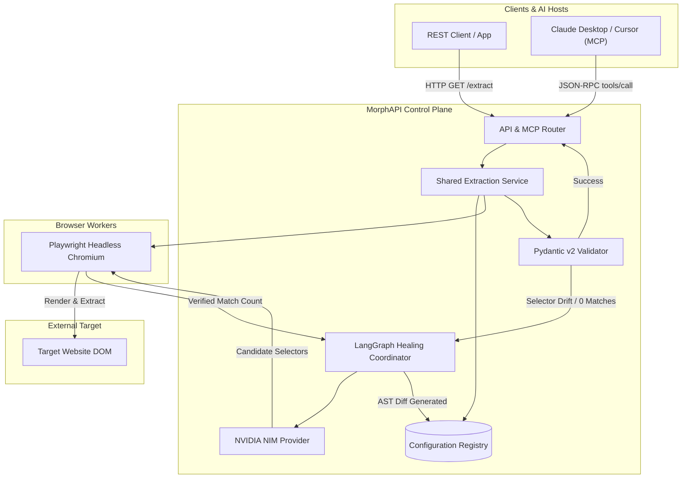

# MorphAPI

## 1. Overview
MorphAPI is an agentic Web-to-API and Model Context Protocol (MCP) gateway that converts unstructured website data into verified, reusable API endpoints. Users provide a target website URL and a desired JSON schema, and the system uses automated browser inspection to discover, test, and deterministically validate candidate CSS selectors. Once verified, the configuration is activated as a high-performance REST endpoint and can be exposed as an MCP tool for compatible AI assistants such as Claude Desktop and Cursor.

## 2. Problem Statement
Extracting data from public websites to feed applications, data pipelines, and AI agents is inherently fragile and maintenance-intensive. Static scrapers rely on hardcoded CSS or XPath selectors that fail whenever a website redesigns, changes class names, or mutates its DOM hierarchy. When failures occur, downstream systems receive broken or empty payloads, causing production outages until engineers manually debug selectors, update code, and redeploy services. Furthermore, integrating extracted web data into AI agent workflows typically requires custom middleware without deterministic schema guarantees.

## 3. Solution
MorphAPI introduces a verified, closed-loop extraction and self-healing lifecycle:
- The user provides a target URL, an optional allowed URL scope, and describes the required data fields.
- An AI agent inspects the website using headless browser automation to analyze rendered DOM structures.
- Candidate selectors are generated and tested directly against the live page to verify element match counts and sample values.
- Extracted values are deterministically validated against schema constraints using Pydantic v2.
- The system activates the endpoint configuration only after deterministic verification passes.
- Compatible AI clients can discover and invoke verified integrations through standard MCP tools.
- When an active website layout changes and causes extraction failures, an autonomous self-healing workflow is triggered to diagnose the failure, synthesize repaired selectors, generate a unified AST diff, and promote the new version with zero downstream downtime.

## 4. Key Features

### Implemented Features (Frontend Control Plane and Simulation Engine)
- **Product-as-Hero Gateway Console**: Monolithic developer interface with an interactive DOM fracture and self-healing simulation engine.
- **Endpoint Authoring Studio (`/create`)**: Prompt-driven endpoint authoring with simulated terminal streaming logs, selector discovery, and schema mapping.
- **Gateway Overview Dashboard (`/dashboard`)**: Central operations console displaying active endpoints, P95 extraction latency, health statuses, and pending self-healing review alerts.
- **REST API Playground (`/playground`)**: Interactive HTTP workbench with configurable headers, cache-bypass controls, latency metrics, and JSON response visualization.
- **Model Context Protocol Gateway Bench (`/mcp`)**: Server-Sent Events (SSE) listener status, client configuration generator (Claude Desktop, Cursor), and a JSON-RPC 2.0 tool execution test bench.
- **Autonomous Self-Healing AST Diff Inspector (`/agent-runs/[id]`)**: Unified visual diff inspector showing broken vs. repaired selectors with human-in-the-loop approval actions (`Approve & Promote to v2` and `Reject Proposal`).
- **Managed Integrations Registry (`/integrations`)**: Complete inventory of active and healing endpoints, version histories, schema definitions, and selector maps.
- **Audit Logging and Activity Feed (`/activity`)**: Chronological audit ledger recording endpoint creation, selector drifts, promotions, and approval decisions.
- **System Configuration (`/settings`)**: AI provider configuration (NVIDIA NIM) and agentic execution limits.
- **Dual Data Source Mode**: Built-in toggle in the sidebar between offline deterministic fixtures (`MOCK FIXTURE`) and live backend routing (`LIVE REST`).

### Planned Backend Service Features (Documented in `docs/`)
- Distributed standalone FastAPI control plane service with worker process isolation.
- Direct connection to live NVIDIA NIM endpoints (`meta/llama-3.1-70b-instruct`) for real-time selector synthesis.
- LangGraph persistent state checkpointing in external relational databases.

## 5. Architecture and Technology Stack

### Component Overview
- **Frontend Console**: Next.js 15, React 19, TypeScript, and Tailwind CSS providing the user interface, interactive playground, and AST diff inspection workbench.
- **Control Plane API**: FastAPI framework handling request routing, configuration lifecycle, and execution dispatching.
- **Browser Automation Worker**: Playwright running headless Chromium for page rendering, DOM inspection, and live selector verification.
- **Deterministic Validation**: Pydantic v2 enforcing field types, required fields, and structural constraints on extracted data.
- **Inference Adapter**: NVIDIA NIM model provider adapter interfacing with generative models for selector hypothesis generation during discovery and healing.
- **Workflow State Engine**: LangGraph coordinating multi-step healing loops, candidate evaluation, and approval interrupts.
- **Protocol Gateway**: Dual-interface gateway providing standard REST JSON endpoints and Model Context Protocol (MCP) tool bindings over Server-Sent Events (SSE) and JSON-RPC 2.0.
- **Persistence**: SQLite with asynchronous SQLAlchemy drivers for endpoint configurations, version history, and audit events.

## 6. System Workflow



### Request Flow
1. **Normal Extraction Path**: An incoming REST or MCP call reaches the shared extraction service. The active selector map is retrieved from the registry. Playwright executes the selectors directly on the rendered DOM without invoking an LLM. Results are validated against the Pydantic schema and returned (<400ms target).
2. **Self-Healing Path**: If a selector fails (returns 0 matches or fails schema validation), the LangGraph coordinator triggers in the background. A sanitized DOM snapshot is sent to the NVIDIA NIM provider to synthesize new selector hypotheses. Playwright tests the candidates against the live page. If verified, an AST diff is generated and held at an approval gate or promoted to a new version based on policy.

## 7. Project Structure

```
MorphAPI/
├── README.md
├── .gitignore
├── Backend/
│   └── .gitkeep
├── Frontend/
│   ├── .eslintrc.json
│   ├── .gitignore
│   ├── .npmrc
│   ├── next.config.ts
│   ├── package.json
│   ├── pnpm-lock.yaml
│   ├── pnpm-workspace.yaml
│   ├── postcss.config.mjs
│   ├── tailwind.config.ts
│   ├── tsconfig.json
│   └── src/
│       ├── app/
│       │   ├── globals.css
│       │   ├── layout.tsx
│       │   ├── page.tsx
│       │   ├── activity/
│       │   │   └── page.tsx
│       │   ├── agent-runs/
│       │   │   ├── page.tsx
│       │   │   └── [id]/
│       │   │       └── page.tsx
│       │   ├── create/
│       │   │   └── page.tsx
│       │   ├── dashboard/
│       │   │   └── page.tsx
│       │   ├── integrations/
│       │   │   ├── page.tsx
│       │   │   └── [id]/
│       │   │       └── page.tsx
│       │   ├── mcp/
│       │   │   └── page.tsx
│       │   ├── playground/
│       │   │   └── page.tsx
│       │   └── settings/
│       │       └── page.tsx
│       ├── components/
│       │   ├── landing/
│       │   │   ├── ArchitectureBlueprint.tsx
│       │   │   ├── HeroInstrument.tsx
│       │   │   ├── InteractionLab.tsx
│       │   │   ├── MechanicalFooter.tsx
│       │   │   ├── MechanicalNavbar.tsx
│       │   │   ├── ProtocolsMatrix.tsx
│       │   │   └── TerminalConversion.tsx
│       │   ├── layout/
│       │   │   ├── AppShell.tsx
│       │   │   ├── Sidebar.tsx
│       │   │   └── Topbar.tsx
│       │   └── ui/
│       │       ├── Badge.tsx
│       │       ├── Button.tsx
│       │       ├── Card.tsx
│       │       ├── DiffViewer.tsx
│       │       ├── ErrorState.tsx
│       │       ├── Skeleton.tsx
│       │       ├── TerminalStream.tsx
│       │       └── Toast.tsx
│       ├── context/
│       │   └── AppContext.tsx
│       ├── lib/
│       │   ├── api-client.ts
│       │   ├── demo-fixtures.ts
│       │   ├── errors.ts
│       │   ├── formatters.ts
│       │   └── utils.ts
│       └── types/
│           ├── api.ts
│           ├── integration.ts
│           ├── mcp.ts
│           └── workflow.ts
└── docs/
    ├── architecture.md
    ├── readme.md
    └── requirements.md
```

## 8. Prerequisites
- **Node.js**: Version 18.18 or higher (Node.js 20+ or 24+ recommended)
- **Package Manager**: pnpm (v9+) or npm (v10+)
- **Browser**: Modern web browser (Chrome, Firefox, Safari, Edge)
- **Optional Backend Runtime**: Python 3.12 with Playwright Chromium for running external backend services

## 9. Installation and Setup

### 1. Clone the Repository
```bash
git clone https://github.com/Jayant-1/MorphAPI.git
cd MorphAPI
```

### 2. Install Frontend Dependencies
```bash
cd Frontend
pnpm install
```

### 3. Build the Application
```bash
pnpm build
```

### 4. Start the Application
To run the production server:
```bash
pnpm start
```
The application will be accessible at `http://localhost:3000`.

To run in development mode with hot-reloading:
```bash
pnpm dev
```

## 10. Environment Variables

Create a `.env.local` file inside the `Frontend` directory if connecting to an external backend service:

| Variable | Description | Default | Required |
|---|---|---|---|
| `NEXT_PUBLIC_API_URL` | Base URL of the MorphAPI backend service | `http://localhost:8000` | No |
| `PORT` | Local port for Next.js HTTP server | `3000` | No |

### Backend Service Environment Variables (Reference)
| Variable | Description | Default | Required |
|---|---|---|---|
| `NIM_API_KEY` | API credential for NVIDIA NIM inference | `<placeholder>` | Yes (for live NIM) |
| `NIM_BASE_URL` | Base endpoint for NVIDIA NIM service | `https://integrate.api.nvidia.com/v1` | No |
| `NIM_MODEL_ID` | Model identifier for selector synthesis | `meta/llama-3.1-70b-instruct` | No |
| `DATABASE_URL` | Connection string for SQLite or PostgreSQL | `sqlite+aiosqlite:///./morphapi.db` | No |
| `REQUIRE_APPROVAL` | Require human review before promoting healed selectors | `true` | No |

## 11. Usage

### Creating an Integration
1. Navigate to **Endpoint Authoring Studio** (`/create`).
2. Enter the target website URL (for example, `https://books.toscrape.com/catalogue/category/books/travel_2/index.html`).
3. Describe the required fields in natural language (for example, *"Extract book title, price formatted in GBP, in-stock status, and star rating"*).
4. Review the real-time browser inspection log and discovered selector match counts.
5. Click **Promote to Active v1** to activate the endpoint.

### Inspecting and Healing Broken Selectors
1. Navigate to **Agent Runs** (`/agent-runs`) or select a degraded endpoint from the Dashboard.
2. Select a run (for example, `run_heal_gh_902`) to view the AST mutation diff.
3. Review the red deletion line showing the broken selector (0 matches) and the green insertion line showing the proposed candidate (verified matches).
4. Click **Approve & Promote to v2** to apply the fix with zero downtime.

### Testing in the REST Playground
1. Navigate to **REST Playground** (`/playground`).
2. Select the target integration from the dropdown menu.
3. Toggle cache-bypass headers if needed (`X-Bypass-Cache: true`).
4. Click **Send** to view the live HTTP status, response duration in milliseconds, and the extracted JSON payload.

## 12. API Reference

### Endpoints API
- `GET /api/v1/endpoints`: Returns a list of all registered integrations.
- `GET /api/v1/endpoints/{id}`: Returns the configuration, schema, and version history of an integration.
- `POST /api/v1/endpoints`: Creates a new endpoint draft and triggers browser selector discovery.
  - Body: `{"targetUrl": "string", "prompt": "string", "name": "string", "allowedScope": "string"}`
- `GET /api/v1/endpoints/{slug}/extract`: Executes fast-path deterministic extraction for the specified endpoint.
  - Query parameters: `bypass_cache` (boolean)
  - Success Response: `200 OK` with `data` payload and `meta` execution latency.

### Agent Runs & Healing API
- `GET /api/v1/agent-runs`: Returns all autonomous generation and healing runs.
- `GET /api/v1/agent-runs/{id}`: Returns run details, step-by-step LangGraph event traces, and AST diff inspection data.
- `POST /api/v1/agent-runs/{id}/approve`: Approves the proposed selector repair and atomically promotes the endpoint version.
- `POST /api/v1/agent-runs/{id}/reject`: Rejects the proposed repair and leaves the endpoint in degraded status.

### Model Context Protocol (MCP) REST API
- `GET /api/v1/mcp/status`: Returns MCP server transport type, SSE endpoint URL, active tools count, and uptime.
- `GET /api/v1/mcp/tools`: Returns the list of registered MCP tool definitions and input schemas.
- `GET /api/v1/mcp/logs`: Returns recent MCP JSON-RPC call logs.
- `POST /api/v1/mcp/execute`: Executes an MCP tool call directly over HTTP.
  - Body: `{"tool": "string", "arguments": {}}`

### Telemetry & Settings API
- `GET /api/v1/activity`: Returns chronological audit events.
- `GET /api/v1/settings/ai-provider`: Returns NVIDIA NIM provider connectivity and model information.
- `GET /api/v1/settings/agent-limits`: Returns configured execution timeout and human approval policy.

## 13. MCP Integration

MorphAPI implements the Model Context Protocol (MCP) specification to expose verified website extractors directly to AI assistants.

### Supported Transports
- **Server-Sent Events (SSE)**: Stream endpoint at `/mcp/sse`.
- **JSON-RPC 2.0**: Message handler at `/mcp/messages`.

### Exposed Tools
1. `list_endpoints`: Returns active, healthy integrations exposed by the gateway.
2. `get_endpoint_schema`: Inspects the JSON schema and active selector mappings for an endpoint.
3. `extract_endpoint_data`: Executes extraction for an endpoint by passing its identifier.
4. Dynamic per-integration tools: Automatically generated tools for each active integration (for example, `extract_books_travel`, `extract_fastapi_releases`, `extract_hacker_news_top`).

### Client Configuration Example
For Claude Desktop (`claude_desktop_config.json`):
```json
{
  "mcpServers": {
    "morphapi": {
      "command": "npx",
      "args": [
        "-y",
        "@morphapi/mcp-server",
        "--endpoint",
        "http://localhost:8000/mcp/sse"
      ]
    }
  }
}
```

For Cursor AI:
Add an MCP server pointing directly to the SSE URL: `http://localhost:8000/mcp/sse`.

## 14. Reliability and Security

### Verification Safeguards
- **Model Is Not the Verifier**: Claims made by an LLM are not treated as truth. Every candidate selector must be executed in Playwright against the live page, and extracted data must satisfy Pydantic schema validation.
- **Atomic Version Promotion**: Unverified selector proposals remain in separate candidate versions and are never served to live clients until validated.
- **Rollback and Retention**: Previous working configurations are preserved as last-known-good versions. When healing fails, the endpoint marks its status as degraded rather than serving corrupted data.

### Network and SSRF Protection
- **Private Subnet Filtering**: All target URLs must resolve through a pre-flight DNS check that blocks private subnets (RFC 1918 addresses `10.0.0.0/8`, `172.16.0.0/12`, `192.168.0.0/16`), loopback addresses (`127.0.0.0/8`), and cloud metadata IP addresses (`169.254.169.254`).
- **Scope Enforcement**: Requests are validated against the endpoint's configured URL wildcard scope to prevent redirection attacks.

## 15. Demo Use Case

### Agricultural Mandi-Price Extraction
The platform includes an intended agricultural use case: extracting commodity market prices from state-level agricultural portals (such as APMC market price bulletin tables).
- **Target Data**: Crop name, district, market yard, modal price, and arrival date.
- **Workflow**: The user defines the target portal URL and commodity schema. MorphAPI inspects the rendered table, identifies CSS selectors for each table column, and validates that prices conform to numeric constraints.
- **Agent Integration**: The active endpoint is exposed as an MCP tool (`extract_mandi_prices`) for a conversational Mandi Price Assistant, allowing farmers and traders to query current prices using natural language.
- **Resilience**: When the underlying government portal modifies table formatting or CSS styling, the self-healing coordinator detects broken columns and proposes updated selectors without interrupting downstream users.

## 16. Limitations
- **Anti-Bot and CAPTCHA Restrictions**: Websites with aggressive anti-automation defenses (such as Cloudflare Turnstile, Arkose Labs, or mandatory CAPTCHAs) cannot be inspected without custom bypass configurations.
- **Complex Authentication**: Workflows requiring multi-factor authentication (MFA) or biometric verification cannot be automated headlessly.
- **Non-DOM Elements**: Data rendered solely inside HTML5 `<canvas>` elements, WebGL viewports, or encrypted media streams cannot be extracted via CSS selectors.
- **Structural Removal**: If a website permanently removes a data field rather than changing its selector, automated healing cannot recover the missing field and requires the user to update the schema.

## 17. Development and Testing

### Frontend Linting and Type Checking
```bash
cd Frontend
pnpm run lint
pnpm run type-check
```

### Production Build Verification
```bash
cd Frontend
pnpm run build
```

## 18. Contributors
- MorphAPI Core Architecture and Frontend Engineering.
