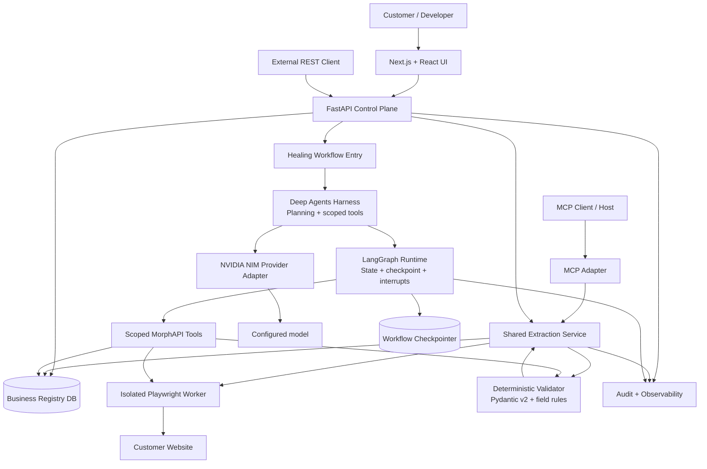
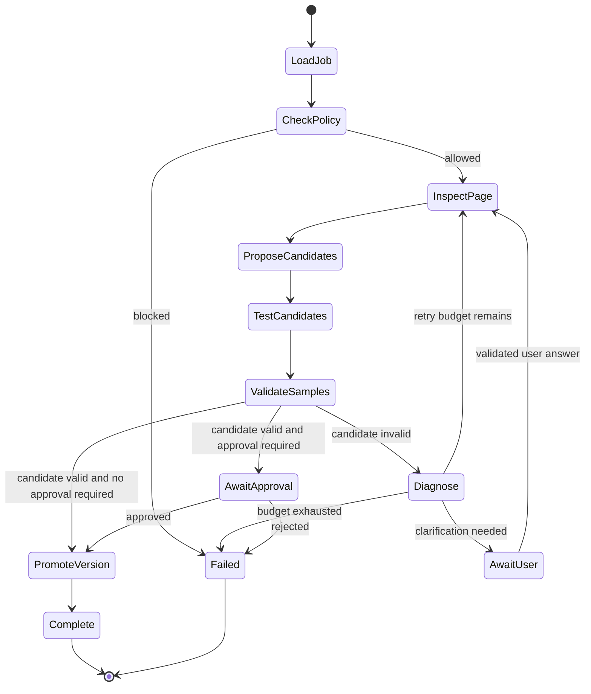

# MorphAPI Architecture

**Status:** Proposed implementation architecture  
**Product:** Self-healing Web-to-API + MCP gateway  
**Primary design:** Shared deterministic extraction gateway with a bounded Deep Agents discovery/healing harness on the LangGraph runtime.

## 1. Executive overview

MorphAPI lets a user turn a website into a reusable API without manually writing and maintaining scraping code for each site. The user provides a URL and the response schema they expect. MorphAPI inspects the website in a real browser, proposes selectors for the requested fields, tests those selectors against rendered content, validates actual extracted values, and activates a versioned endpoint configuration only after the backend verifies it.

When the website changes, the normal extraction path may fail. MorphAPI then opens a bounded healing workflow. Deep Agents provides the agent harness for planning, multi-step tool use, context management, and optional delegated investigations. LangGraph supplies the workflow runtime, state transitions, checkpoints, resumability, and human-approval interrupts. The model is an investigator and proposal generator, not the source of truth. Browser execution, schema validation, configuration promotion, and persistence remain deterministic application responsibilities.

Once a configuration is active, REST and MCP use the same shared extraction service. There is no separate scraping implementation for MCP and no per-customer generated server.

## 2. Product goals and non-goals

### Goals

- Convert a customer URL and schema into a verified endpoint configuration.
- Extract rendered and dynamic website content using Playwright.
- Produce evidence-backed selector candidates and deterministic verification results.
- Detect broken selectors and attempt bounded, auditable repair.
- Support human clarification/approval when automation cannot confidently resolve ambiguity.
- Expose the same verified extraction capability through REST and MCP.
- Keep configuration versions, active/last-known-good versions, workflow state, and audit history.
- Make failures visible and actionable rather than returning fake or stale success.
- Keep the normal extraction path low-latency and model-free.

### Non-goals for the initial implementation

- Generating and deploying a separate Python service for every customer.
- Allowing an LLM to execute arbitrary code, write directly to the registry, or mark its own result verified.
- Guaranteeing that every website is scrapeable, especially sites with CAPTCHAs, inaccessible authentication, anti-bot blocks, or legal/contractual restrictions.
- Automatically bypassing access controls, paywalls, CAPTCHAs, or site restrictions.
- Treating model-generated JSON as proof that a real extraction succeeded.
- Allowing the agent to redefine the customer's schema without explicit user approval.

## 3. High-level architecture



### Runtime separation

There are two distinct request paths:

1. **Normal API extraction path:** API/MCP → shared extraction service → verified config → Playwright → deterministic validation → response. It does not invoke an LLM or the agent workflow if the active selector configuration works.
2. **Discovery/healing path:** a configuration creation request or failed extraction starts the bounded agentic workflow. Deep Agents can choose among narrow tools and organize the investigation. LangGraph controls workflow execution, checkpointing, timeouts, retries, and approval pauses. The backend independently validates every candidate before it can become active.

## 4. Technology and responsibilities

| Layer | Technology | Responsibility |
|---|---|---|
| Web UI | Next.js, React, TypeScript, Tailwind | Onboarding, schema editor, evidence preview, approvals, endpoint dashboard, healing history |
| API/control plane | FastAPI | Authentication boundary, endpoint lifecycle, REST routes, job creation, status and audit APIs |
| Shared extraction service | Python service layer | Loads active config, orchestrates browser extraction, validates output, normalizes errors |
| Browser worker | Playwright | Navigate to allowed URL, wait for rendered DOM, inspect elements, test selectors, extract values |
| Static parsing helpers | BeautifulSoup/lxml | Optional HTML inspection or parsing; not a replacement for browser testing where JS rendering matters |
| Validation | Pydantic v2 + deterministic field rules | Type/schema validation, required-field checks, empty/invalid-value checks, cross-field constraints |
| Agent harness | Deep Agents (`deepagents`) | Planning, scoped tool use, context management, optional independent subtask delegation |
| Workflow runtime | LangGraph | State machine execution, checkpointing, resume, controlled branching, human-in-the-loop interrupts |
| Model | Explicit NVIDIA NIM endpoint/model | Selector hypotheses, page-structure reasoning, failure diagnosis, clarification drafting |
| Business persistence | SQLite initially | Customers, endpoint definitions, config versions, audit events, healing jobs; production database choice is a deployment decision |
| Workflow persistence | LangGraph checkpointer | Workflow execution snapshots and resumable graph state; separate from authoritative business records |
| Protocol adapter | MCP server/adapter | Maps MCP tool calls into shared application service calls |
| Observability | Structured logs, metrics, traces | Latency, browser failures, model calls, validation failures, healing outcomes, resource use |

Deep Agents is an agent harness on top of LangChain agent abstractions and the LangGraph runtime; LangGraph remains the layer responsible for graph state, persistence/checkpointing, streaming, and interrupts. See the official [Deep Agents architecture](https://github.com/langchain-ai/deepagents/blob/main/libs/ARCHITECTURE.md) and [LangGraph persistence documentation](https://github.com/langchain-ai/docs/blob/main/src/oss/langgraph/persistence.mdx).

## 5. Core application modules

Recommended logical package structure (implementation may adjust names but must preserve boundaries):

```text
morphapi/
  app/
    main.py                    # FastAPI app construction and lifespan
    config.py                  # Typed environment configuration
    api/
      endpoints.py             # Endpoint create/read/update/activate routes
      extract.py               # REST extraction route
      jobs.py                  # Discovery/healing job status and resume
      health.py                # Liveness/readiness and capability checks
    schemas/
      endpoint.py              # Request/response and config contracts
      extraction.py            # Extraction result and field evidence
      workflow.py              # Workflow state and event contracts
      errors.py                # Stable public error model
    services/
      endpoint_service.py      # Lifecycle, versions, activation rules
      extraction_service.py    # Shared REST/MCP extraction implementation
      validation_service.py    # Deterministic schema and field validation
      registry_service.py      # Repository-facing business operations
      healing_service.py       # Start/coordinate healing jobs
      audit_service.py         # Append-only audit event facade
    browser/
      playwright_manager.py    # Browser lifecycle, contexts, timeouts
      page_inspector.py        # DOM summary and candidate element context
      selector_tester.py       # Tests selector against actual rendered page
      extractor.py             # Extracts actual field values
      url_policy.py            # URL scope, DNS/IP, redirect and SSRF controls
    agent/
      builder_agent.py         # Deep Agents construction with explicit model
      tools.py                 # Narrow typed MorphAPI tools
      prompts.py               # Versioned system instructions
      nim_provider.py          # NVIDIA NIM adapter / model construction
      compatibility.py         # Tool-call preflight and readiness state
    workflows/
      graph.py                 # LangGraph workflow nodes and transitions
      state.py                 # Typed graph state
      policies.py              # Retry/step/time budgets and stop conditions
      interrupts.py            # Human approval/clarification pause/resume
      checkpointer.py          # Persistent checkpoint setup
    mcp/
      server.py                # MCP server wiring
      tools.py                 # Thin tool definitions calling services
    db/
      models.py                # ORM or persistence records
      repository.py            # Transactional repository operations
      migrations/              # Schema evolution
    observability/
      logging.py
      metrics.py
      tracing.py
  tests/
    unit/
    contract/
    integration/
    e2e/
```

This is a logical layout, not a requirement to create every file in one initial commit. Do not collapse agent, browser, validation, and persistence into one monolithic module.

## 6. User-facing workflows

### 6.1 Create an endpoint

1. User signs in and selects **Create API**.
2. User enters the starting URL, allowed URL scope, output JSON schema, field descriptions, optional extraction hints, and expected freshness.
3. FastAPI validates the request and creates a draft endpoint plus a discovery job.
4. The browser worker checks URL policy before navigation. It blocks unsafe schemes, local/private network destinations, disallowed redirects, and out-of-scope navigation.
5. Playwright loads the page and captures a bounded DOM summary, page metadata, candidate element context, and relevant visible text.
6. The agent may use this evidence to propose candidate selectors and extraction strategies through scoped tools. The page content is untrusted data; it cannot override instructions.
7. The selector tester executes candidates against the actual rendered page and extracts sample values.
8. The deterministic validator checks field presence, types, normalization, configured constraints, and schema compatibility.
9. The UI shows candidate selectors, sample values, validation results, and confidence/evidence. Confidence scores can assist ranking but never replace validation.
10. If multiple candidates are ambiguous or required values are inaccessible, the workflow asks the user a focused clarification question.
11. Only after backend verification (and any configured approval) does the endpoint service promote a version to active.
12. The user receives the endpoint URL, response schema, and MCP tool availability.

### 6.2 Call an active API

1. REST client calls a generated route with any allowed parameters; alternatively an MCP client calls the corresponding tool.
2. The adapter resolves the endpoint ID and reads its active verified configuration.
3. Shared extraction service checks tenant authorization, quotas, URL policy, cache policy, and configuration status.
4. Playwright extracts actual values using verified selectors.
5. The validator normalizes and validates the output against the immutable active schema.
6. The service returns the validated response with request ID, configuration version, freshness metadata, and stable error codes.
7. Audit/metrics capture the result without logging secrets or unnecessarily storing page content.

If extraction passes, the service returns without calling NVIDIA NIM or starting Deep Agents/LangGraph.

### 6.3 Heal a broken endpoint

1. An active extraction fails a deterministic check: selector not found, empty required field, schema mismatch, navigation failure, or changed page structure.
2. The service records the failure and applies policy: retry a transient browser failure within a small limit; otherwise enqueue a healing job. Do not silently return unvalidated data as success.
3. The healing workflow loads the active version and last-known-good version, schema, failure details, recent sanitized evidence, and previous repair attempts.
4. Deep Agents plans a bounded investigation and uses only registered MorphAPI tools, such as inspect page, inspect element context, test selectors, extract sample data, validate extraction, and request clarification.
5. LangGraph state tracks the job, attempts, evidence references, proposed candidates, approvals, and outcome. A persistent checkpointer allows a failed or interrupted job to resume.
6. Every candidate is tested in Playwright and passed through backend validation. The model cannot self-certify.
7. If a candidate passes, the backend stores it as a new version and promotes it atomically only after policy requirements are met.
8. If approval is required, the workflow pauses through an interrupt and resumes only with validated user input.
9. If all bounded attempts fail, the endpoint stays in a clear degraded/needs-attention state; preserve the last-known-good config and provide actionable diagnostics. Do not activate an unverified candidate.
10. Emit audit events for start, tool execution summaries, validation, approval, promotion, rollback, and terminal failure.

### 6.4 Human clarification / approval

Human input is required when the system cannot reliably infer a required field, when two candidates are similarly plausible, when the output would change in a materially incompatible way, or when policy requires approval. The workflow must show what decision is needed, the evidence, the impact, and available options. User input is revalidated as untrusted data.

## 7. Deep Agents + LangGraph design

### 7.1 Division of responsibility

- **Deep Agents harness:** supports long-horizon planning, context management, optional isolated subagents, and selection among available tools.
- **LangGraph runtime:** executes stateful workflows; owns transitions, checkpointing, resume, interrupt/approval points, and bounded orchestration.
- **NVIDIA NIM model:** reasons over sanitized page evidence and tool results, proposes next investigation actions, and drafts explanations/clarification requests.
- **MorphAPI tools:** perform narrowly scoped, typed operations.
- **Deterministic services:** own browser execution, actual selector tests, schema validation, database writes, activation, versioning, and audit truth.

Do not create multiple autonomous agents by default. Delegation is optional and should be enabled only for a concrete independent task such as separately investigating two page regions. Every child task must have bounded inputs, time/step budgets, and schema-validated output.

### 7.2 Suggested graph states



The graph should have explicit maximum tool calls, maximum candidate count, total wall-clock deadline, retry budget, and per-tool timeouts. Use stable workflow/thread IDs. Make side effects idempotent so a resumed graph does not create duplicate versions or duplicate activation events.

### 7.3 Scoped tool surface

Recommended tools (all typed and server-validated):

- `inspect_website(url, scope_id)` — inspect a URL already allowed by policy; returns bounded, sanitized evidence.
- `inspect_element_context(page_ref, region_hint)` — returns relevant DOM/text context, not arbitrary full browser internals.
- `test_selectors(page_ref, candidates)` — executes candidate selectors in Playwright and returns actual counts and sample values.
- `extract_sample_data(page_ref, selector_map)` — performs real extraction for a candidate map.
- `validate_extraction(schema_id, sample)` — invokes deterministic validation and returns field-level issues.
- `diagnose_extraction_failure(failure_id)` — returns sanitized failure details and relevant prior attempts.
- `request_customer_clarification(question, choices, evidence_refs)` — creates a pending clarification; it does not send unreviewed arbitrary messages outside the product.
- `submit_candidate_configuration(draft_id, selector_map, rationale, evidence_refs)` — records a candidate in a non-active state. It does not activate or mark it verified.
- `get_endpoint_status(endpoint_id)` — read-only status lookup.

Avoid tools like `run_shell`, unrestricted `fetch_url`, arbitrary SQL, direct registry writes, or `activate_endpoint` in the model's tool list. Activation is a backend-controlled transition after validation and optional approval.

### 7.4 Model/provider compatibility preflight

Before enabling discovery/healing for an environment, test the exact NVIDIA NIM base URL and model ID for:
- a real tool-call request and correctly parsed tool-call response;
- a tool result round-trip and a second model decision;
- malformed arguments and schema-validation failure behavior;
- timeout, rate-limit, and server-error handling;
- maximum context/tool output behavior for representative DOM evidence;
- any required vision/image capability separately, if the product later needs screenshots.

Do not assume every NIM-served model supports the same tool-calling or vision behavior. If preflight fails, mark agentic features not ready and keep endpoint activation disabled for configurations requiring the agent workflow. Do not silently substitute a different model.

## 8. Configuration lifecycle and data ownership

Recommended lifecycle:

`draft → inspecting → candidate_ready → verified → active → degraded/needs_attention → healing → active (new version)`.

A rejected or invalid candidate remains non-active. Keep a separate version history and retain the previous last-known-good version according to retention policy. Promotion is an atomic backend transaction. The active schema is immutable for that configuration version; schema changes create a new draft/version and may require re-verification.

Business registry records and workflow checkpoints have separate ownership:
- **Business DB:** authoritative endpoint state, schemas, verified selector maps, versions, approvals, audit events, tenant ownership.
- **LangGraph checkpointer:** resumable execution state, messages/tool outputs needed for workflow continuation, pending interrupts, graph progress.
- **Optional artifact/evidence store:** sanitized page evidence or larger outputs, with access controls and retention. Store references in graph state rather than huge DOM dumps where possible.

Do not treat checkpoint contents as the authoritative registry and do not update business records merely because the graph resumes.

## 9. Suggested data model

Exact column types can follow the selected persistence library, but the concepts must exist.

- `tenants`: tenant identity and policy settings.
- `users` / `memberships`: authorization and role boundaries if auth is in scope.
- `endpoints`: stable endpoint identity, tenant, slug, status, active version ID.
- `endpoint_versions`: immutable schema, selector map, URL scope, verification result, creation source, version number, last-known-good marker.
- `discovery_jobs`: job ID, endpoint/draft ID, workflow thread ID, status, deadline, attempt count, result summary.
- `healing_attempts`: previous version, failure class, candidate version, verification outcome, start/end timestamps.
- `approvals`: pending decision, sanitized evidence references, approver, outcome, timestamp.
- `audit_events`: append-only actor/action/target/result metadata with correlation ID.
- `request_logs` or metrics store: request status, latency, config version, error code, freshness; avoid storing raw secrets or unnecessary page content.

SQLite is acceptable for local development and an initial single-instance prototype. Before multi-worker or horizontally scaled production, choose a database and migration strategy that support concurrent writes, operational backup, access controls, and migrations. Configure a durable LangGraph checkpointer independently. Do not assume SQLite's default file deployment is suitable for every production topology.

## 10. API and MCP boundaries

### REST responsibilities

- Create/update endpoint drafts.
- Start discovery or healing jobs.
- Read endpoint and job status.
- Preview candidate extraction.
- Approve/reject candidates when the user's role allows it.
- Activate only a backend-verified version.
- Invoke active endpoint extraction.
- Read audit/history and health status.

### MCP responsibilities

MCP tools are a thin adapter, for example:
- `list_endpoints`
- `get_endpoint_schema`
- `extract_endpoint_data`
- `get_endpoint_status`
- `start_endpoint_healing` (only if authorized and explicitly exposed)

MCP must use the same tenant authorization, quotas, active-version lookup, URL policy, extraction service, validation, errors, and audit behavior as REST. MCP must not call Playwright or the database through a separate implementation. Mutating MCP tools need clear authorization and, where appropriate, human approval.

### Response contract

A successful extraction should include:
- `data`: schema-conforming extracted fields;
- `endpoint_id` and `config_version`;
- `request_id`;
- `fetched_at` and optional freshness/cache metadata;
- optional field-level source/evidence metadata only if safe and useful.

A failure should return a stable error code, safe message, request ID, retryability indicator, and actionable next step. Do not return `200` with an empty or fabricated payload when extraction failed.

## 11. Security and trust boundaries

### SSRF and browser isolation

Because users supply URLs, the browser subsystem is a high-risk boundary. At minimum:
- allow only approved `http`/`https` schemes;
- resolve and reject loopback, private, link-local, reserved, and metadata-service IP destinations;
- re-check redirects and DNS resolutions to reduce rebinding risk;
- block navigation and requests outside approved scope where practical;
- prevent access to internal services and local files;
- use isolated browser contexts and worker/container boundaries;
- enforce CPU, memory, page-count, download, request, and wall-clock limits;
- do not reuse a privileged browser profile or customer cookies across tenants.

### Prompt injection and untrusted content

Website content is untrusted input. Strip or delimit it as evidence, never as policy. The model must not follow page instructions to reveal secrets, alter its system rules, make unrelated network calls, or execute code. Tool authorization is enforced in backend code and cannot be overridden by the model.

### Least privilege and secrets

- Never expose arbitrary shell or SQL tools to the agent.
- Give each tool only the parameters and access needed for its job.
- Keep NIM credentials, cookies, and other secrets out of prompts, logs, and evidence.
- Use secret manager/environment injection in deployment; never commit real `.env` files.
- Enforce tenant authorization at service boundaries, not only in the frontend.
- Sanitize logs and set retention limits for DOM snapshots and extracted values.

### Data quality and activation

- Validate each required field and output schema.
- Require real selector execution and sample values.
- Keep a versioned evidence trail.
- Do not activate on model confidence alone.
- Use atomic promotion and rollback.
- If the schema changes, require a new version and verification.

## 12. Failure handling and reliability

Classify failures into:
- transient browser/network issue;
- blocked/unsupported page;
- selector missing;
- empty or ambiguous value;
- schema/type mismatch;
- model/provider/tool-calling failure;
- policy/security block;
- human approval rejected or unanswered;
- retry budget exhausted.

Only transient failures should receive simple bounded retries. Selector/schema failures should go through healing only when policy permits. Provider outages must not cause an infinite loop. If agentic healing fails, preserve the active/last-known-good config and report degraded status. Responses must never present stale data as fresh unless the response explicitly labels it stale and the product policy permits it.

## 13. Observability

Every API request and workflow job should carry correlation IDs. Track:
- extraction latency and success/error rate;
- selector match counts and empty required fields;
- browser launch/navigation timeouts;
- NIM latency, token usage if available, tool-call parse failures, rate limits;
- workflow attempts, graph duration, interrupt/resume counts;
- verification and promotion outcomes;
- REST/MCP parity failures;
- resource use and per-tenant quotas.

Use structured logs and metrics; keep high-cardinality or sensitive page content out of metric labels. Record concise audit summaries rather than full prompts or raw pages unless there is a documented, access-controlled reason.

## 14. Deployment shape

Initial local setup may run:
- Next.js frontend;
- FastAPI application;
- Playwright browser dependencies and isolated worker process;
- SQLite business DB;
- persistent local checkpointer for development;
- configured NVIDIA NIM endpoint reachable from the API worker.

A production deployment should separate browser workloads from the API process, use a durable database and checkpointer, protect the NIM endpoint/credentials, add queue/worker capacity for discovery and healing, and enforce quotas and timeouts. Do not assume a local SQLite file or in-process browser pool can safely support multiple replicas.

## 15. Test strategy and release gates

Must pass before a release:
1. Unit tests for URL policy, selector parsing, normalization, field validation, status transitions, and error mapping.
2. Contract tests for Pydantic models, REST responses, MCP tool schemas, and shared-service behavior.
3. Real Playwright integration tests against a controlled fixture website containing static and JavaScript-rendered content.
4. A failure fixture that changes selectors, proves healing candidates are tested in a real browser, and proves only a valid candidate can be promoted.
5. NVIDIA NIM compatibility tests against the exact configured endpoint/model; mocks may be used for unit tests but cannot substitute for the provider acceptance gate.
6. Workflow tests for bounded retries, persistent checkpoint/resume, interruption, rejected approval, idempotent promotion, and provider failure.
7. REST/MCP parity tests proving identical data/error semantics for the same endpoint and configuration.
8. Security tests for SSRF, redirects, private IPs, prompt injection, cross-tenant access, and secret redaction.
9. End-to-end test covering create → inspect → candidate → actual validation → activate → REST extraction → MCP extraction → selector failure → healing → verified version promotion.
10. No fake success: a failed browser extraction, invalid sample, failed NIM tool call, or rejected approval must result in a visible failure/degraded state.

## 16. Three-person implementation split

- **Person 1 — Core backend and integration:** FastAPI, contracts, registry, database, endpoint lifecycle, shared extraction service, validation, REST, observability, integration ownership.
- **Person 2 — Browser, NIM, and agentic workflow:** Playwright manager/inspector/tester, NIM provider adapter, compatibility preflight, Deep Agents tool surface, LangGraph state/workflow/checkpointer, healing.
- **Person 3 — Frontend and MCP:** Next.js onboarding/dashboard/evidence/approval flows, MCP adapter/tools, REST/MCP parity tests, UX for failures and healing history.

The team agrees contracts first. Merge work behind stable interfaces; do not allow each person to invent their own response schemas or duplicate extraction logic.

## 17. Decisions to confirm before production

- Authentication provider, roles, and tenant model.
- Allowed URL scope policy and whether authentication to target websites is in scope.
- Exact output schema language and supported selector types.
- Cache/freshness behavior and whether stale values may ever be returned.
- Production business database and LangGraph checkpointer.
- Background job queue and browser worker isolation model.
- NIM endpoint, model ID, context limits, tool-call behavior, and image capability if needed.
- Data retention, evidence storage, audit retention, and deletion requirements.
- Rate limits, billing/quota model, and supported endpoint count.
- Legal/compliance review for website access and stored page data.

These are intentionally explicit decisions, not assumptions the agent should make silently.
