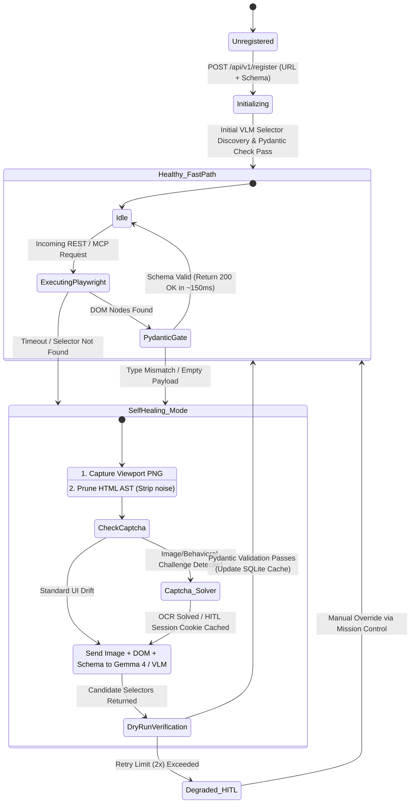
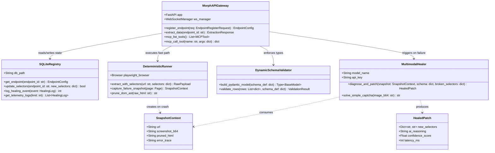
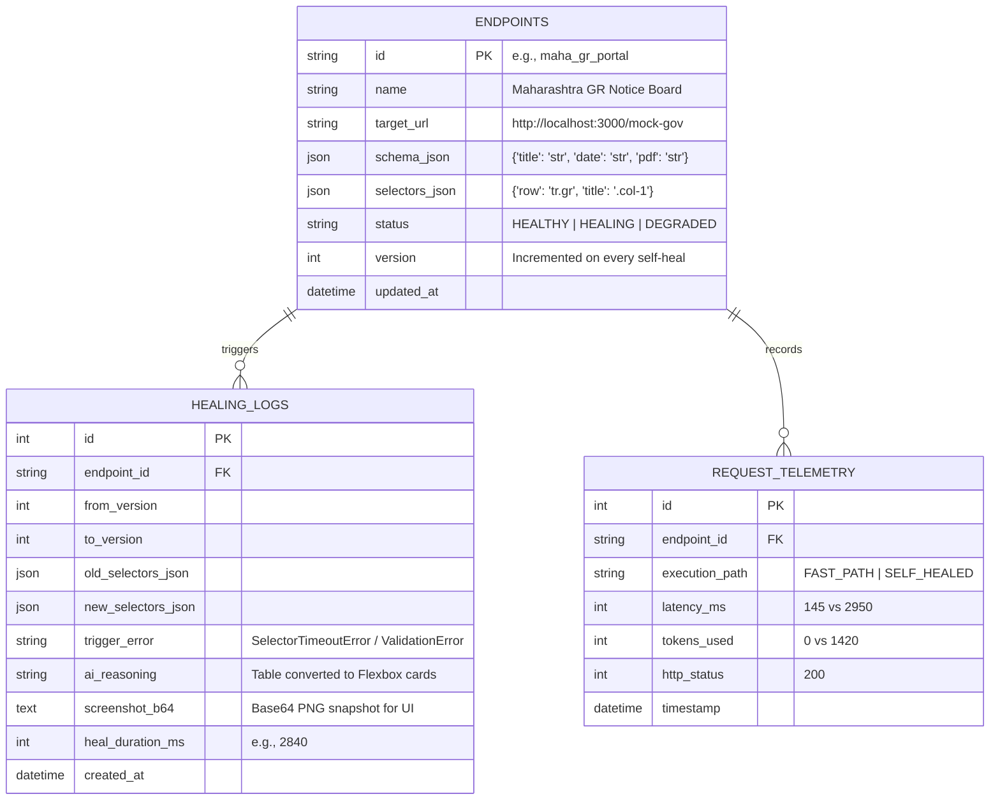

# MorphAPI — System Design & UML Architectural Blueprints

This document contains the complete visual engineering specifications for **MorphAPI**. All diagrams are provided in **Mermaid.js** (which renders natively inside your GitHub `README.md`) alongside **ASCII Architecture Diagrams** for terminal docs and presentation slides.

---

## 1. High-Level System Context & Architecture Diagram (C4 Level 2)

This diagram illustrates how downstream consumers (WhatsApp bots, civic apps, and MCP AI Agents) interact with MorphAPI's Dual-Path Execution Engine.

```mermaid
graph TB
    subgraph Consumers ["Downstream Consumers & AI Agents"]
        REST["Civic App / WhatsApp Bot<br/>(REST JSON Consumer)"]
        Agent["Autonomous AI Agent<br/>(Claude / Cursor / LangChain)"]
        Admin["Developer / Judge<br/>(Browser)"]
    end

    subgraph MorphAPI ["MorphAPI Gateway (FastAPI + Python)"]
        Router["API & MCP Protocol Router<br/>(/api/v1/extract & /mcp/sse)"]
        Registry[("SQLite State &<br/>Selector Vault")]
        Runner["Fast Deterministic Runner<br/>(Playwright Headless)"]
        Validator["Runtime Schema Gate<br/>(Pydantic Dynamic Model)"]
        
        subgraph Healer ["Autonomous Multimodal Self-Healing Engine"]
            Pruner["DOM AST Pruner<br/>(85% Token Reduction)"]
            Snap["Viewport & Bounding-Box<br/>PNG Capturer"]
            VLM["Multimodal Vision Engine<br/>(Gemma 4 / Open-Weight VLM)"]
        end
        
        WS["WebSocket Telemetry Broadcaster"]
    end

    subgraph Targets ["Target Legacy Portals"]
        MockGov["Local Mock Civic Portal<br/>(Maha GR / Mandi Board + Chaos UI)"]
        LiveGov["Live Legacy Portals<br/>(gr.maharashtra.gov.in / MSAMB)"]
    end

    subgraph Dashboard ["Next.js Mission Control UI"]
        Feed["Live Healing Telemetry Feed"]
        Diff["Visual Screenshot & Selector Diff"]
    end

    REST -->|GET /api/v1/data/:id| Router
    Agent -->|MCP Tool Call: extract_legacy_data| Router
    Router <-->|Fetch Cached Selectors| Registry
    Router -->|Execute Fast Path| Runner
    Runner -->|Scrape DOM| MockGov
    Runner -.->|Scrape DOM| LiveGov
    Runner -->|Raw Extracted Dict| Validator

    Validator -->|Valid Schema (0 Tokens, ~150ms)| Router
    Validator -->|ValidationError / Timeout Tripwire| Pruner
    Validator -->|Trigger Visual Capture| Snap

    Pruner -->|Cleaned HTML Tree| VLM
    Snap -->|Base64 Viewport PNG| VLM
    VLM -->|Patched CSS Selectors + Reasoning| Validator
    VLM -->|Hot-Swap Selectors| Registry

    Router -.->|Stream Events| WS
    VLM -.->|Stream Healing Diff| WS
    WS ==>|Real-Time Updates| Feed
    WS ==>|Visual Proof| Diff
    Admin -->|Click 'Chaos: Redesign UI'| MockGov
```

---

## 2. UML Sequence Diagram: Fast Path vs. Self-Healing Loop

This sequence diagram shows the exact runtime lifecycle when a developer or judge clicks the **"Chaos: Redesign UI"** button during the live demo.

```mermaid
sequenceDiagram
    autonumber
    actor Client as AI Agent / REST Client
    participant API as FastAPI Gateway
    participant DB as SQLite Registry
    participant PW as Playwright Runner
    participant Target as Target Civic Portal
    participant VLM as Gemma 4 / Vision LLM
    participant UI as Mission Control UI (WS)

    Note over Client, UI: CASE 1: Normal Operation (Zero-Token Fast Path)
    Client->>API: GET /api/v1/data/pune_mandi
    API->>DB: Get cached selectors & Pydantic schema
    DB-->>API: Returns {"crop": ".mandi-crop", "price": ".rate-val"}
    API->>PW: Extract using cached selectors
    PW->>Target: Load DOM & query selectors
    Target-->>PW: Returns raw strings
    PW-->>API: Validate against Pydantic Schema (PASS)
    API->>UI: WS Event: FAST_PATH_OK (142ms, 0 Tokens)
    API-->>Client: 200 OK (healed: false, data: [...])

    Note over Client, UI: ⚡ JUDGE CLICKS "CHAOS: REDESIGN UI" ON TARGET PORTAL ⚡

    Note over Client, UI: CASE 2: Broken UI -> Autonomous Self-Healing Path
    Client->>API: GET /api/v1/data/pune_mandi (Request Paused, No 500 Error)
    API->>DB: Get cached selectors
    API->>PW: Attempt extraction with ".mandi-crop"
    PW->>Target: Query ".mandi-crop" (Element Missing / Timeout!)
    PW-->>API: Raises SelectorBrokenException / ValidationError
    API->>UI: WS Event: HEALING_TRIGGERED (Selector '.mandi-crop' failed)

    rect rgb(40, 30, 50)
        Note right of API: Multimodal Self-Healing Loop
        API->>PW: Capture Viewport PNG + Prune DOM AST (<script>/<style> stripped)
        PW->>Target: Snapshot screen & HTML tree
        Target-->>PW: PNG + Clean HTML
        PW-->>API: Visual + Structural Context Payload
        API->>VLM: Prompt(Screenshot, Pruned DOM, Target Schema, Old Selector)
        VLM-->>API: JSON: {"crop": "[data-card-title]", "price": ".new-price-badge", "reason": "Table converted to CSS Grid cards"}
    end

    API->>PW: Re-test new selectors on live page
    PW->>Target: Query "[data-card-title]" & ".new-price-badge"
    Target-->>PW: Returns valid data rows
    PW-->>API: Pydantic Schema Validation (PASS!)
    API->>DB: Hot-swap & persist new selectors + Write Audit Log
    API->>UI: WS Event: HEAL_COMPLETE (3.1s, Patched Diff + Screenshot)
    API-->>Client: 200 OK (healed: true, data: [...])
```



---

## 3. UML Activity / State Machine Diagram: Endpoint Lifecycle

This state diagram models how an endpoint transitions between healthy deterministic execution, healing mode, and human-in-the-loop fallback.



---

## 4. UML Class Diagram: Backend Modules (`FastAPI` + `Playwright` + `VLM`)

This class diagram gives your teammates a clear blueprint of the exact classes and methods in the Python backend.



---

## 5. Entity-Relationship Diagram (ERD): SQLite Database

This ERD shows the relational structure stored inside `morphapi.db`.



---

## 6. Data Flow Diagram (DFD): DOM AST Pruning & Multimodal Context Pipeline

Judges in the **15% Understanding of Implementation** category will ask: *"How do you fit a massive government webpage into the LLM without blowing up token limits or waiting 30 seconds?"* Use this diagram to explain your pipeline.

```text
[ Raw Legacy Webpage (55,000+ Tokens) ]
       │
       ├──► 1. Playwright Viewport Renderer ──────────────────► [ Compressed JPEG/PNG Screenshot ]
       │                                                                       │
       └──► 2. BeautifulSoup4 / lxml AST Parser                                │
               ├── Strip <script>, <style>, <svg>, <noscript>, <meta>          │
               ├── Remove inline style="..." and data-reactid attributes       │
               ├── Collapse empty nested <div> wrappers                        │
               └── Retain structural tags (<table>, <div>, <a>, id, class)     │
                       │                                                       │
                       ▼                                                       ▼
            [ Pruned Structural DOM (~3,200 Tokens) ]              [ Visual Layout Grid ]
                       │                                                       │
                       └───────────────────┬───────────────────────────────────┘
                                           │
                                           ▼
                     ╔═══════════════════════════════════════════╗
                     ║   Gemma 4 / Open-Weight Vision Prompt     ║
                     ║  • System: Strict JSON Selector Compiler  ║
                     ║  • Inputs: Screenshot + Pruned DOM        ║
                     ║  • Target: Pydantic Field Schema          ║
                     ╚═════════════════════╤═════════════════════╝
                                           │
                                           ▼
                     [ Verified CSS Selector Patch (JSON) ]
```