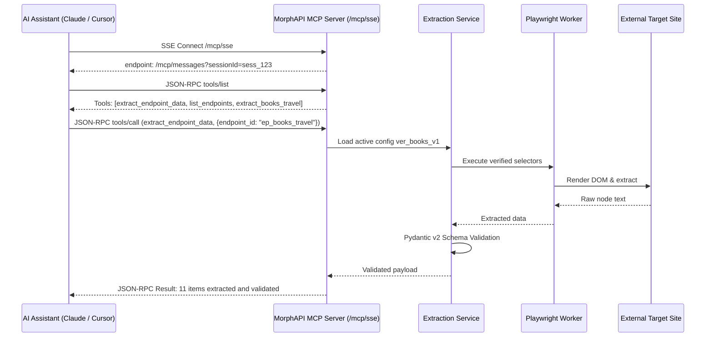

# MorphAPI REST & Model Context Protocol (MCP) Specification

## 1. Overview

MorphAPI exposes a dual-protocol gateway:
1. **REST API**: High-performance HTTP JSON interface for web applications, background workers, and automation scripts.
2. **Model Context Protocol (MCP)**: Anthropic-standardized JSON-RPC 2.0 and Server-Sent Events (SSE) interface allowing AI assistants (Claude Desktop, Cursor AI, Agent Workers) to discover, inspect, and invoke web extractors as native tools.

Both interfaces invoke the **exact same underlying extraction service** and share the same verified selector registry.

---

## 2. Global Request & Response Envelopes

All MorphAPI endpoints return a standardized JSON envelope to guarantee deterministic consumption across services.

### Success Envelope (`ApiResponseEnvelope<T>`)
```json
{
  "data": { ... },
  "meta": {
    "requestId": "req_01JAX89Z14",
    "endpointId": "ep_books_travel",
    "configVersion": 1,
    "fetchedAt": "2026-10-24T18:42:10.124Z",
    "latencyMs": 342,
    "isDemoData": false
  }
}
```

### Error Envelope (`ApiErrorResponse`)
```json
{
  "error": {
    "code": "SELECTOR_DRIFT_DETECTED",
    "message": "Field 'versionTag' selector matched 0 DOM nodes on rendered target page.",
    "requestId": "req_01JAX89Z15",
    "retryable": false,
    "details": {
      "field": "versionTag",
      "selector": "section a.Link--primary",
      "targetUrl": "https://github.com/fastapi/fastapi/releases"
    }
  }
}
```

### Standard Error Codes

| Code | HTTP Status | Description | Retryable |
|---|---|---|---|
| `UNAUTHORIZED` | 401 | Missing or invalid API key | No |
| `FORBIDDEN_SCOPE` | 403 | Target URL is outside the endpoint's configured allowed scope | No |
| `NOT_FOUND` | 404 | Integration, version, or run ID does not exist | No |
| `SSRF_BLOCKED` | 400 | Target URL resolves to a private, loopback, or metadata IP address | No |
| `SELECTOR_DRIFT_DETECTED` | 502 | One or more required selectors matched 0 elements | Yes (via healing) |
| `SCHEMA_VALIDATION_ERROR` | 422 | Extracted values failed deterministic Pydantic v2 validation | No |
| `BROWSER_TIMEOUT` | 504 | Playwright navigation or rendering exceeded configured timeout | Yes |
| `NETWORK_ERROR` | 503 | Target website is unreachable or returned HTTP 5xx | Yes |

---

## 3. REST API Endpoints Specification

### 1. Endpoints Registry

#### `GET /api/v1/endpoints`
Returns a list of all registered integrations.
- **Query Parameters**:
  - `status` (string, optional): Filter by status (`active`, `degraded`, `healing`, `draft`).
- **Response**: `200 OK` with `data: Integration[]`.

#### `GET /api/v1/endpoints/{id}`
Returns complete configuration, schema, and version history for a specific integration.
- **Path Parameters**:
  - `id` (string, required): Endpoint ID (e.g. `ep_books_travel`).
- **Response**: `200 OK` with `data: Integration`.

#### `POST /api/v1/endpoints`
Creates a new endpoint draft and triggers browser selector discovery.
- **Request Body**:
  ```json
  {
    "name": "FastAPI Release Notes",
    "targetUrl": "https://github.com/fastapi/fastapi/releases",
    "prompt": "Extract the latest release version tag, publication date, and changelog markdown.",
    "allowedScope": "github.com/fastapi/fastapi/releases*"
  }
  ```
- **Response**: `201 Created` with `data: Integration`.

#### `GET /api/v1/endpoints/{slug}/extract`
Executes fast-path browser extraction using the active configuration version.
- **Path Parameters**:
  - `slug` (string, required): Endpoint URL slug (e.g. `books-travel`).
- **Query Parameters**:
  - `bypass_cache` (boolean, optional, default: `false`): Force fresh Playwright extraction.
- **Headers**:
  - `X-Bypass-Cache: true` (alternative to query param).
- **Response**: `200 OK` with extracted JSON payload conforming to the endpoint's schema.

---

### 2. Autonomous Healing & Agent Runs

#### `GET /api/v1/agent-runs`
Returns chronological agent runs.
- **Query Parameters**:
  - `type` (string, optional): Filter by `healing`, `generation`, or `execution`.
  - `status` (string, optional): Filter by `running`, `completed`, `awaiting_approval`, `failed`.
- **Response**: `200 OK` with `data: AgentRun[]`.

#### `GET /api/v1/agent-runs/{id}`
Returns detailed run telemetry, step-by-step LangGraph event traces, and AST selector diffs.
- **Path Parameters**:
  - `id` (string, required): Run ID (e.g. `run_heal_gh_902`).
- **Response**: `200 OK` with `data: AgentRun`.

#### `POST /api/v1/agent-runs/{id}/approve`
Approves the proposed selector repair and atomically promotes the endpoint to a new version.
- **Path Parameters**:
  - `id` (string, required): Run ID awaiting approval.
- **Response**: `200 OK` with `{"data": {"approved": true}}`.

#### `POST /api/v1/agent-runs/{id}/reject`
Rejects the proposed selector fix and leaves the endpoint in degraded status.
- **Path Parameters**:
  - `id` (string, required): Run ID awaiting approval.
- **Response**: `200 OK` with `{"data": {"rejected": true}}`.

---

### 3. Operations & Configuration

#### `GET /api/v1/activity`
Returns the append-only audit log.
- **Response**: `200 OK` with `data: ActivityEvent[]`.

#### `GET /api/v1/settings/ai-provider`
Returns status and preflight readiness of the configured NVIDIA NIM endpoint.
- **Response**: `200 OK` with `data: AiProviderConfig`.

#### `GET /api/v1/settings/agent-limits`
Returns execution constraints, maximum tool calls, and timeout policies.
- **Response**: `200 OK` with `data: AgentLimitsConfig`.

---

## 4. Model Context Protocol (MCP) Specification

MorphAPI adheres strictly to the **Model Context Protocol (MCP)** specification, exposing web extractors directly to AI assistants.



### Supported Transports
1. **Server-Sent Events (SSE)**: Stream endpoint located at `http://localhost:8000/mcp/sse`.
2. **JSON-RPC 2.0**: Bidirectional message handler at `http://localhost:8000/mcp/messages`.

### Core Exposed Tools

#### 1. `list_endpoints`
Returns all active, healthy integrations exposed by the gateway.
- **Input Schema**:
  ```json
  {
    "type": "object",
    "properties": {
      "status": { "type": "string", "description": "Optional status filter (e.g. 'active')" }
    }
  }
  ```

#### 2. `get_endpoint_schema`
Inspects the JSON Schema, field definitions, and active version details for an endpoint.
- **Input Schema**:
  ```json
  {
    "type": "object",
    "properties": {
      "endpoint_id": { "type": "string", "description": "Unique identifier of endpoint" }
    },
    "required": ["endpoint_id"]
  }
  ```

#### 3. `extract_endpoint_data`
Executes browser-backed data extraction for a specific endpoint.
- **Input Schema**:
  ```json
  {
    "type": "object",
    "properties": {
      "endpoint_id": { "type": "string", "description": "Target endpoint ID" },
      "refresh": { "type": "boolean", "description": "Bypass cache and force fresh Playwright extraction" }
    },
    "required": ["endpoint_id"]
  }
  ```

#### 4. `request_endpoint_healing`
Manually triggers a bounded self-healing agentic workflow if selectors have degraded.
- **Input Schema**:
  ```json
  {
    "type": "object",
    "properties": {
      "endpoint_id": { "type": "string", "description": "Target endpoint ID" },
      "failure_hint": { "type": "string", "description": "Description of missing or corrupted fields" }
    },
    "required": ["endpoint_id"]
  }
  ```

---

## 5. Client Integration Configurations

### Claude Desktop Configuration
Add the MorphAPI gateway to `claude_desktop_config.json`:
```json
{
  "mcpServers": {
    "morphapi": {
      "command": "npx",
      "args": [
        "-y",
        "@morphapi/mcp-server",
        "--endpoint",
        "http://localhost:8000/mcp/sse"
      ]
    }
  }
}
```

### Cursor AI Configuration
In Cursor AI Settings → Features → MCP:
1. Click **+ Add New MCP Server**.
2. Name: `MorphAPI`.
3. Type: `SSE`.
4. URL: `http://localhost:8000/mcp/sse`.
