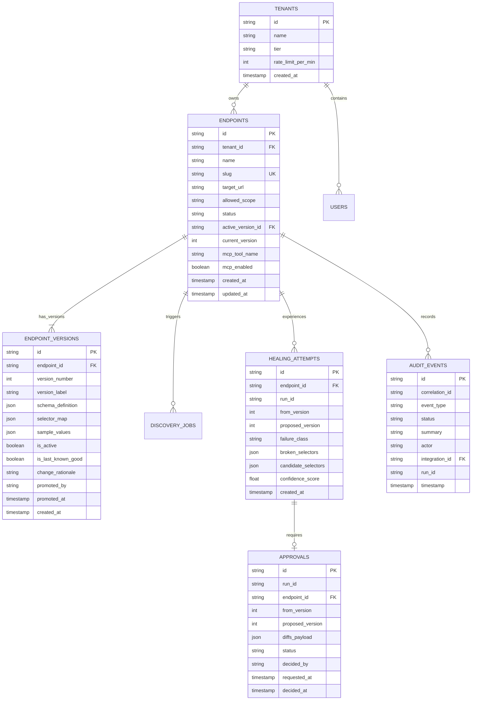

# MorphAPI Database Schema & Persistence Contract

## 1. Overview

MorphAPI uses a relational data model designed around **immutable versioning** and **strict auditability**. Every active endpoint references an immutable configuration version snapshot. When selectors drift or layouts change, new candidate versions are stored separately and atomically promoted only after passing verification.

---

## 2. Table Specifications

### 1. `tenants`
Tracks multi-tenant isolation, policy boundaries, and resource quotas.
- `id` (VARCHAR(36), PK): UUID of the tenant.
- `name` (VARCHAR(255), NOT NULL): Organization or workspace name.
- `tier` (VARCHAR(50), NOT NULL, DEFAULT 'free'): Subscription or resource quota tier.
- `rate_limit_per_min` (INTEGER, DEFAULT 60): Max extractions allowed per minute.
- `created_at` (TIMESTAMP, NOT NULL): Creation timestamp.

### 2. `endpoints`
Represents the stable public identity of a Web-to-API integration.
- `id` (VARCHAR(36), PK): Stable endpoint identifier (e.g. `ep_books_travel`).
- `tenant_id` (VARCHAR(36), FK -> `tenants.id`): Owning tenant.
- `name` (VARCHAR(255), NOT NULL): Human-readable name.
- `slug` (VARCHAR(128), UNIQUE, NOT NULL): URL slug used in extraction path (`/api/v1/endpoints/{slug}/extract`).
- `target_url` (TEXT, NOT NULL): Full starting URL of the target website.
- `allowed_scope` (TEXT, NOT NULL): Wildcard scope pattern (e.g. `books.toscrape.com/catalogue/*`) preventing SSRF redirects.
- `status` (VARCHAR(32), NOT NULL): Current lifecycle status (`draft`, `inspecting`, `candidate_ready`, `verified`, `active`, `degraded`, `healing`, `failed`).
- `active_version_id` (VARCHAR(36), FK -> `endpoint_versions.id`, NULLABLE): Currently served configuration version.
- `current_version` (INTEGER, DEFAULT 1): Highest promoted version number.
- `mcp_tool_name` (VARCHAR(128), NOT NULL): Identifier exposed over Model Context Protocol (e.g. `extract_books_travel`).
- `mcp_enabled` (BOOLEAN, DEFAULT TRUE): Whether the tool is exposed to AI clients.
- `created_at` (TIMESTAMP, NOT NULL): Timestamp of initial draft creation.
- `updated_at` (TIMESTAMP, NOT NULL): Last configuration update timestamp.

### 3. `endpoint_versions`
Immutable snapshots of selector configurations and schema contracts.
- `id` (VARCHAR(36), PK): Version snapshot ID (e.g. `ver_books_v1`).
- `endpoint_id` (VARCHAR(36), FK -> `endpoints.id`, NOT NULL): Parent endpoint.
- `version_number` (INTEGER, NOT NULL): Monotonically increasing version (1, 2, 3).
- `version_label` (VARCHAR(16), NOT NULL): Display label (e.g. `v1`, `v2`).
- `schema_definition` (JSON, NOT NULL): Full JSON Schema specifying required fields and types.
- `selector_map` (JSON, NOT NULL): Mapping of field names to verified CSS/XPath selectors.
- `sample_values` (JSON, NULLABLE): Verified sample values extracted during validation.
- `is_active` (BOOLEAN, DEFAULT FALSE): Whether this version is currently handling traffic.
- `is_last_known_good` (BOOLEAN, DEFAULT FALSE): Fallback marker used during self-healing investigations.
- `change_rationale` (TEXT, NULLABLE): Description of what changed (e.g. "Healed broken title selector").
- `promoted_by` (VARCHAR(255), NULLABLE): Actor who approved promotion (`auto_validator` or user email).
- `promoted_at` (TIMESTAMP, NULLABLE): Promotion timestamp.
- `created_at` (TIMESTAMP, NOT NULL): Snapshot creation timestamp.

### 4. `healing_attempts`
Records autonomous healing loop executions and candidate evaluations.
- `id` (VARCHAR(36), PK): Attempt ID (e.g. `heal_att_01`).
- `endpoint_id` (VARCHAR(36), FK -> `endpoints.id`, NOT NULL): Target endpoint.
- `run_id` (VARCHAR(64), NOT NULL): Associated agent run ID.
- `from_version` (INTEGER, NOT NULL): Degraded version number.
- `proposed_version` (INTEGER, NOT NULL): Target version number.
- `failure_class` (VARCHAR(64), NOT NULL): Category of failure (e.g. `SELECTOR_MATCH_ZERO`, `SCHEMA_TYPE_MISMATCH`).
- `broken_selectors` (JSON, NOT NULL): Selector map that caused the failure.
- `candidate_selectors` (JSON, NOT NULL): Repaired selectors proposed by NVIDIA NIM.
- `confidence_score` (FLOAT, NOT NULL): Model confidence metric (0.00 - 1.00).
- `created_at` (TIMESTAMP, NOT NULL): Start timestamp.

### 5. `approvals`
Human-in-the-loop review tickets holding proposed selector changes.
- `id` (VARCHAR(36), PK): Approval ticket ID (e.g. `appr_gh_902`).
- `run_id` (VARCHAR(64), NOT NULL): Associated workflow run.
- `endpoint_id` (VARCHAR(36), FK -> `endpoints.id`, NOT NULL): Target integration.
- `from_version` (INTEGER, NOT NULL): Existing version.
- `proposed_version` (INTEGER, NOT NULL): Target version.
- `diffs_payload` (JSON, NOT NULL): Array of `SelectorDiff` records with match counts and samples.
- `status` (VARCHAR(32), NOT NULL, DEFAULT 'pending'): `pending`, `approved`, or `rejected`.
- `decided_by` (VARCHAR(255), NULLABLE): Email or user ID of reviewer.
- `requested_at` (TIMESTAMP, NOT NULL): When the interrupt paused the workflow.
- `decided_at` (TIMESTAMP, NULLABLE): When the operator clicked approve or reject.

### 6. `audit_events`
Append-only ledger recording all security-relevant and operational actions.
- `id` (VARCHAR(36), PK): Unique audit event ID.
- `correlation_id` (VARCHAR(64), NOT NULL): Distributed trace ID linking frontend requests to backend workers.
- `event_type` (VARCHAR(64), NOT NULL): Category (`endpoint_created`, `verification_passed`, `version_promoted`, `healing_started`, `healing_approved`, `healing_failed`).
- `status` (VARCHAR(16), NOT NULL): `success`, `warning`, `error`, `info`.
- `summary` (TEXT, NOT NULL): Concise description of the event.
- `actor` (VARCHAR(255), NOT NULL): Actor initiating the event (`system_monitor`, `auto_validator`, or user email).
- `integration_id` (VARCHAR(36), FK -> `endpoints.id`, NULLABLE): Related integration.
- `run_id` (VARCHAR(64), NULLABLE): Related workflow run.
- `timestamp` (TIMESTAMP, NOT NULL): Event creation timestamp.

---

## 3. Storage Separation: Business Registry vs. LangGraph Checkpointer

MorphAPI explicitly separates the **authoritative business database** from the **ephemeral workflow checkpointer**:

| Storage Domain | Engine | Contents | Ownership & Retention |
|---|---|---|---|
| **Authoritative Business Registry** | SQLite (Dev) / PostgreSQL (Prod) | Customers, endpoints, immutable versions, audit ledgers, approvals. | Permanent, transactional, ACID-compliant, backed up daily. |
| **LangGraph Checkpointer** | SQLite / Redis / Postgres Checkpoint Adapter | State snapshots, serialized tool call messages, retry counters, interrupt states. | Ephemeral; purged 14 days after job completion or terminal failure. |
| **Evidence & Artifact Store** | Local filesystem / S3 Enclave | Raw sanitized DOM snapshots, Playwright screenshots. | Short-term retention (48 hours) with strict redaction of credentials. |
