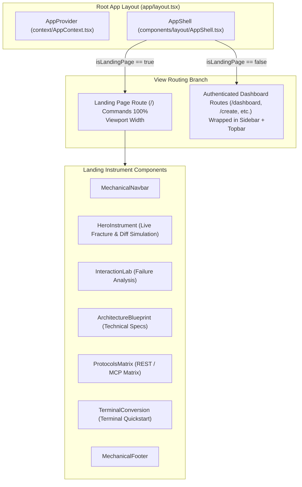
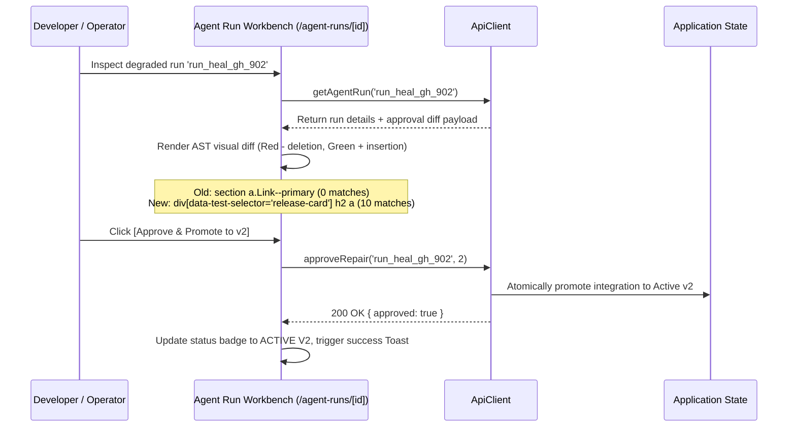

# MorphAPI Frontend Architecture

## 1. Overview

The MorphAPI frontend is a production-grade, Next.js 15 (App Router) single-page application built with React 19, TypeScript, and Tailwind CSS. It is designed around the **Product-as-Hero** aesthetic and **Swiss Typographic Minimalism**, presenting the platform as a high-precision, tactile digital instrument rather than a generic SaaS dashboard.



---

## 2. Route Hierarchy & Page Catalog

The frontend exposes 12 distinct routes designed for endpoint management, simulation, playground execution, and self-healing review:

| Route | Component File | Key Functionality |
|---|---|---|
| `/` | `src/app/page.tsx` | Full-width product-as-hero console featuring interactive DOM fracture simulation, AST mutation diffing, and protocol matrix. |
| `/dashboard` | `src/app/dashboard/page.tsx` | Central operations console displaying active endpoint count, P95 extraction latency, health indicators, and pending approval alerts. |
| `/create` | `src/app/create/page.tsx` | Natural language endpoint authoring studio with streaming terminal logs, selector discovery, and live DOM preview. |
| `/integrations` | `src/app/integrations/page.tsx` | Complete registry of managed integrations, status filters (`active`, `degraded`, `healing`, `draft`), and version badges. |
| `/integrations/[id]` | `src/app/integrations/[id]/page.tsx` | Detailed integration inspector with active schema definitions, selector maps, version history, and rapid test execution. |
| `/playground` | `src/app/playground/page.tsx` | Interactive REST query workbench with configurable headers (`X-Bypass-Cache: true`), latency benchmarking, and formatted JSON output. |
| `/mcp` | `src/app/mcp/page.tsx` | Model Context Protocol gateway bench, Server-Sent Events (SSE) listener status, Claude Desktop & Cursor configuration generator, and live tool execution test bench. |
| `/agent-runs` | `src/app/agent-runs/page.tsx` | Chronological ledger of autonomous generation and healing runs with stage chips and status filters. |
| `/agent-runs/[id]` | `src/app/agent-runs/[id]/page.tsx` | Autonomous self-healing workbench featuring stage-by-stage LangGraph event timelines, unified AST selector diff inspection, and human approval controls. |
| `/activity` | `src/app/activity/page.tsx` | Append-only audit feed recording endpoint lifecycle events, selector drifts, promotions, and actor correlation IDs. |
| `/settings` | `src/app/settings/page.tsx` | System configuration workbench for NVIDIA NIM inference providers and agentic execution limits. |

---

## 3. Layout Architecture (`AppShell`)

The layout architecture balances full-width marketing presentation with a dense, utilitarian developer console:

```typescript
// Frontend/src/components/layout/AppShell.tsx
export function AppShell({ children }: { children: React.ReactNode }) {
  const pathname = usePathname();
  const isLandingPage = pathname === "/";

  // Landing page bypasses dashboard sidebar and topbar
  if (isLandingPage) {
    return (
      <div className="min-h-screen bg-[#0A0D0F] text-[#F3F4F6] selection:bg-[#FF4D00] selection:text-black">
        <main>{children}</main>
        <ToastContainer />
      </div>
    );
  }

  // Dashboard routes include precision sidebar and topbar rails
  return (
    <div className="flex min-h-screen bg-[#07090A] text-[#E5E7EB]">
      <Sidebar />
      <div className="flex-1 flex flex-col min-w-0">
        <Topbar />
        <main className="flex-1 p-6 overflow-y-auto">{children}</main>
      </div>
      <ToastContainer />
    </div>
  );
}
```

---

## 4. State Management & Dual-Mode Client Architecture

MorphAPI provides a resilient, zero-friction client layer via `ApiClient` (`src/lib/api-client.ts`) and `AppContext` (`src/context/AppContext.tsx`).

```mermaid
flowchart TD
    UI[Frontend Page Component] -->|Calls apiClient.getIntegrations()| Client[ApiClient]
    Client --> ModeCheck{Demo Mode Active?}
    ModeCheck -->|true (MOCK FIXTURE)| MemoryDB[Read from demo-fixtures.ts & LocalStorage]
    ModeCheck -->|false (LIVE REST)| BackendAPI[HTTP Fetch -> FastAPI Backend http://localhost:8000]
    MemoryDB --> Envelope[Wrap in ApiResponseEnvelope<T>]
    BackendAPI --> Envelope
    Envelope --> UI
```

### 1. Dual Data-Source Toggle
- Located at the bottom of the navigation sidebar.
- Allows operators to switch instantaneously between **`MOCK FIXTURE`** (offline deterministic scenarios) and **`LIVE REST`** (routing to FastAPI on `http://localhost:8000`).
- State is preserved across reloads via `localStorage.getItem("morphapi_demo_mode")`.

### 2. Client-Side Simulation Fixtures
- Complete in-browser fixture suite (`src/lib/demo-fixtures.ts`) modeling real-world scraping targets:
  - `ep_books_travel`: Travel book catalog with price, rating, and stock fields.
  - `ep_gh_releases`: FastAPI GitHub releases tracker in an active self-healing state (`run_heal_gh_902`).
  - `ep_hn_top`: Hacker News top stories endpoint previously healed and promoted to `v2`.
- Local additions (such as newly created endpoints in `/create`) are saved to `localStorage`, allowing full lifecycle testing without an active database.

---

## 5. The Interactive AST Diff Inspection Engine

A standout feature of the frontend is the unified **AST Selector Diff Viewer** implemented in `src/app/agent-runs/[id]/page.tsx` and mirrored in the landing page `HeroInstrument.tsx`.



### Visual Diff Presentation
- **Broken Selector Line (Red)**:
  `- section a.Link--primary (0 DOM matches — FAILED)`
- **Validated Candidate Line (Green)**:
  `+ div[data-test-selector='release-card'] h2 a (10 DOM matches — VERIFIED)`
- **Operator Actuation Buttons**:
  - `[APPROVE & PROMOTE TO V2]`: Performs an atomic version promotion, unblocking downstream REST and MCP clients.
  - `[REJECT PROPOSAL]`: Rejects the candidate selector and retains the endpoint in degraded status for further inspection.

---

## 6. Swiss Typographic Design System

The visual design is governed by strict typographic and layout rules defined in `tailwind.config.ts`:
- **Geometry**: Strict `0px` border radius (`rounded-none`). No pill badges or rounded cards.
- **Palette**: Deep mechanical black (`#07090A`, `#0A0D0F`), muted steel borders (`#1F2429`, `#2D333B`), signal amber (`#D29922`), and high-energy hazard orange (`#FF4D00`).
- **Typography**: Clean sans-serif titles paired with dense, monospaced data readouts (`font-mono`) displaying memory addresses, millisecond execution timings, and selector expressions.
