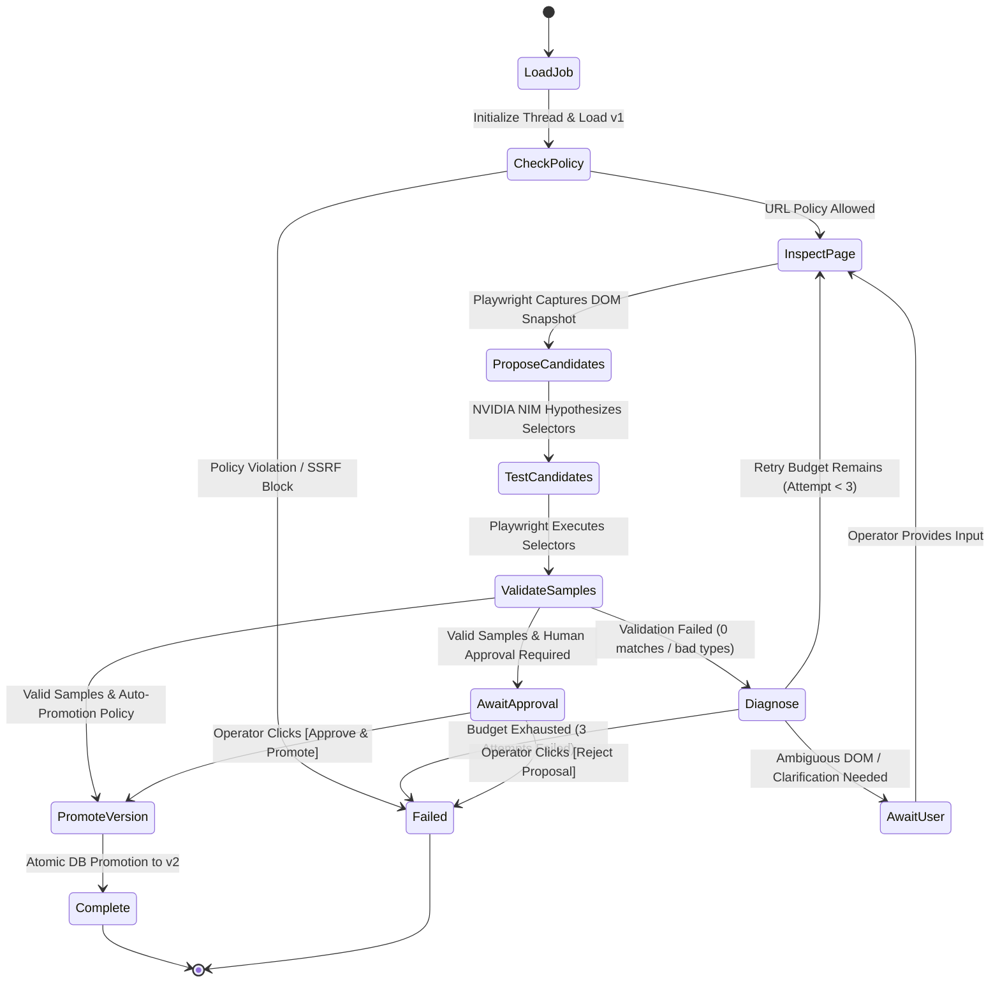
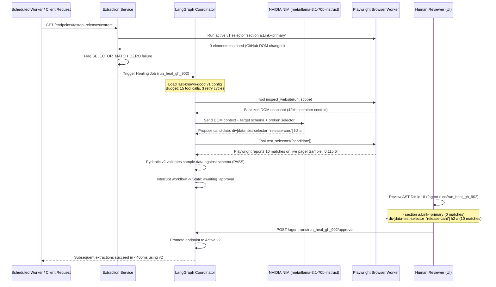

# MorphAPI Self-Healing & Agentic Workflow

## 1. Overview

MorphAPI's self-healing engine combines **LangGraph** (for durable state transitions, persistent checkpointing, and human-in-the-loop interrupts) with **Deep Agents** (for long-horizon planning and scoped tool use) and **NVIDIA NIM** (for generative reasoning over mutated markup).

The core principle of this workflow is: **The model is an investigator and hypothesis generator, never the source of truth.** No repaired selector is ever promoted to production without passing live browser testing in Playwright and deterministic Pydantic v2 schema validation.

---

## 2. LangGraph State Machine Architecture



---

## 3. Step-by-Step Self-Healing Lifecycle



---

## 4. Scoped Agent Tool Surface

To enforce least-privilege security, the LLM agent is provided with only typed, server-validated tools. It is strictly forbidden from executing arbitrary shell commands, accessing raw filesystems, or writing directly to the database.

| Tool Name | Arguments | Description | Output Guarantee |
|---|---|---|---|
| `inspect_website` | `url`, `scope_id` | Navigates to target website using Playwright; checks SSRF policy. | Sanitized DOM outline stripped of scripts/styles. |
| `inspect_element_context` | `page_ref`, `region_hint` | Extracts detailed attributes and child nodes around a specific DOM area. | Bounded HTML snippet (<10KB). |
| `test_selectors` | `page_ref`, `candidates` | Evaluates CSS/XPath selectors against live rendered page in Playwright. | Real match counts and first 3 extracted text values. |
| `extract_sample_data` | `page_ref`, `selector_map` | Runs complete candidate selector map across all required fields. | Raw extracted dictionary of field values. |
| `validate_extraction` | `schema_id`, `sample` | Invokes deterministic Pydantic v2 validation service. | Boolean pass/fail with field-level diagnostic messages. |
| `diagnose_extraction_failure` | `failure_id` | Retrieves historical failure logs, previous selector maps, and error traces. | Sanitized error taxonomy report. |
| `request_customer_clarification` | `question`, `choices`, `evidence_refs` | Creates a human clarification interrupt when multiple DOM nodes are ambiguous. | Holds workflow state until user responds in UI. |
| `submit_candidate_configuration` | `draft_id`, `selector_map`, `rationale` | Submits candidate configuration to candidate registry (does NOT activate). | Candidate version ID. |

---

## 5. NVIDIA NIM Provider Adapter

MorphAPI connects to NVIDIA NIM using an OpenAI-compatible API adapter configured with:
- **Model Identifier**: `meta/llama-3.1-70b-instruct`
- **Base Endpoint**: `https://integrate.api.nvidia.com/v1`
- **Temperature**: `0.1` (low temperature to favor deterministic syntax over creative deviation)

### Prompt Construction Strategy
1. **System Persona**: High-precision DOM mutation analyst.
2. **Context Injection**:
   - The exact customer schema and field requirements.
   - The original broken CSS selector and why it failed (e.g. 0 matches).
   - Sanitized structural HTML surrounding the likely target data.
3. **Strict Output Rules**:
   - Return valid CSS or XPath selectors with high specificity (avoiding fragile autogenerated classes).
   - Prefer stable attributes (`data-test-selector`, semantic tags `h1`, `article`, `table`, `time`).

### Tool-Calling Preflight Gate
On server startup, MorphAPI executes an automated preflight check against the configured NIM endpoint:
- Verifies successful authentication and network connectivity.
- Executes a synthetic tool call and parses the returned JSON arguments.
- Verifies tool result ingestion and final response completion.
- If the preflight fails, agentic capabilities are marked `UNAVAILABLE` to prevent runtime failures; MorphAPI refuses to silently fall back to an unverified model.

---

## 6. AST Selector Diff Generation

When a repaired selector passes verification, the LangGraph engine constructs a `SelectorDiff` structure:

```typescript
export interface SelectorDiff {
  fieldName: string;
  oldSelector: string;
  newSelector: string;
  oldMatchCount: number;
  newMatchCount: number;
  sampleOldValue?: string | number | null;
  sampleNewValue?: string | number | null;
  confidence: number;
}
```

This payload is delivered to the frontend console (`/agent-runs/[id]`), rendering an immediate visual diff:
- **Red Line**: Shows the obsolete selector, zero match count, and broken state.
- **Green Line**: Shows the validated candidate selector, non-zero element matches, and verified sample value extracted from the live page.
- **Reviewer Action**: Clicking **Approve & Promote to v2** sends an HTTP `POST` to `/api/v1/agent-runs/{id}/approve`, promoting the version atomically with zero downtime for downstream clients.
