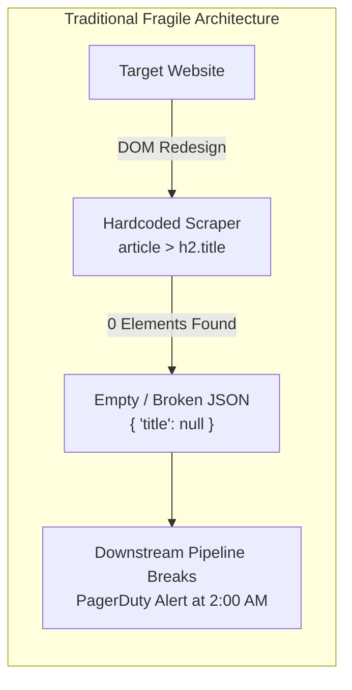
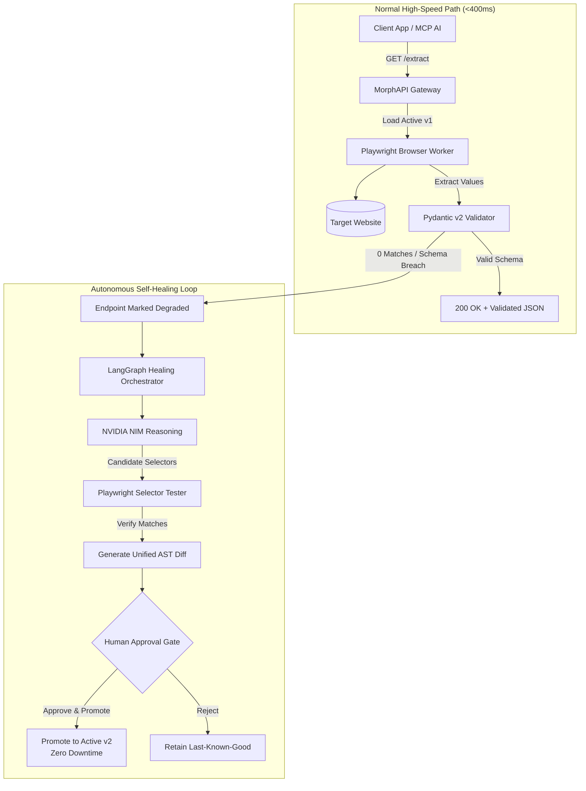

# MorphAPI System Overview

## 1. Executive Summary

**MorphAPI** is an autonomous self-healing Web-to-API and Model Context Protocol (MCP) gateway. It converts dynamic, unstructured website data into deterministic, schema-validated REST endpoints and live MCP tools for AI agents (such as Claude Desktop and Cursor).

Modern software systems and autonomous AI agents require live web data to make decisions. However, building and maintaining web scrapers is notoriously fragile: static CSS selectors break whenever target websites redesign, change class names, or modify their DOM trees. MorphAPI solves this by closing the extraction loop:
1. **Natural Language Onboarding**: Users provide a target URL and describe desired fields.
2. **Browser-Backed Discovery**: Headless Chromium (Playwright) inspects rendered content and tests candidate selectors.
3. **Deterministic Verification Gate**: Extracted values must strictly validate against Pydantic schemas before activation.
4. **Autonomous Self-Healing**: When a website layout mutates, LangGraph orchestrates an agentic investigation with NVIDIA NIM to diagnose failures, test candidate selectors, generate an AST mutation diff, and atomically promote the repaired version.
5. **Universal Consumption**: Active endpoints are immediately accessible via standard REST JSON and Model Context Protocol (MCP) tool bindings.

---

## 2. The Problem: "The 2:00 AM Outage Problem"

Traditional web extraction architectures rely on hardcoded CSS or XPath selectors embedded in microservices, Celery tasks, or Lambda functions:



### Why Scraping Fails in Production
- **CSS Class Churn**: Modern frameworks (Next.js, Tailwind, Emotion, styled-components) generate randomized, hashed, or ephemeral class names (`.css-1x8b0q`) that shift across deployments.
- **Silent Degradation**: Scrapers often fail silently by returning empty arrays or `null` values instead of throwing HTTP errors, corrupting analytics databases and tripping AI models into hallucinating.
- **Manual Debugging Overhead**: Repairing broken scrapers requires an engineer to open Chrome DevTools, inspect DOM mutations, craft new selectors, test edge cases, update code, commit, and redeploy.
- **AI Agent Context Gap**: AI assistants have no native, reliable way to ingest live web data without custom middleware or fragile scraping tools that lack deterministic schema guarantees.

---

## 3. The MorphAPI Solution: Closed-Loop Self-Healing

MorphAPI replaces static, fragile scrapers with a self-correcting gateway:



### Core Tenets of the MorphAPI Architecture
1. **The Model Is Not the Verifier**: Language models hypothesize candidate selectors based on sanitized DOM evidence, but the model's claim is never taken as truth. Only live Playwright browser execution that yields actual element match counts and validates against Pydantic schemas can certify a selector.
2. **Deterministic Validation**: No candidate configuration can be promoted to active status without passing strict schema validation.
3. **Zero Downstream Downtime**: In the event of a selector break, previous configurations are preserved as last-known-good backups while the self-healing engine synthesizes and verifies candidates.
4. **Fast Path Remains Model-Free**: Normal extractions execute in sub-400ms without invoking language models or agent loops.

---

## 4. Product-as-Hero Design Philosophy

MorphAPI's developer interface rejects generic SaaS aesthetics (floating colorful gradients, glassmorphism cards, and stock marketing illustrations). Instead, it adopts **Swiss Typographic Minimalism** and treats the product as a physical, precision-machined digital instrument:

- **Instrument Console**: 92% viewport width hardware bench featuring high-contrast monospaced telemetry, physical rocker toggles, and live system meters.
- **Interactive Fracture Simulation**: Users can press `[TRIGGER SIMULATED DOM BREAKAGE]` to watch live telemetry turn red (`SELECTOR_MATCH_COUNT: 0`), observe the LangGraph healing loop in real-time, inspect the AST mutation diff, and actuate `[APPROVE & PROMOTE TO V2]`.
- **Tactile AST Diff Reviewer**: Visual inline diff viewer displaying broken selectors in red strikethrough alongside validated green replacement candidates.

---

## 5. Real-World Demonstration: Agricultural Mandi Prices

To demonstrate practical enterprise utility, MorphAPI includes an agricultural market price extraction use-case based on state Agricultural Produce Market Committee (APMC) portals.

### The Problem
Government agricultural portals publish daily commodity price bulletins in dynamic HTML tables. Farmers, trading cooperatives, and logistics apps rely on this data. However, portal markup changes unpredictably, breaking data ingestion.

### MorphAPI Implementation
1. **Target**: State APMC bulletin portal.
2. **Schema**:
   ```json
   {
     "commodity": "Wheat / Chana / Mustard",
     "market_yard": "string",
     "district": "string",
     "modal_price_inr": "number",
     "arrival_date": "string (YYYY-MM-DD)"
   }
   ```
3. **Verification**: Playwright inspects the rendered table and verifies that price columns parse to valid numeric values (`modal_price_inr > 0`).
4. **MCP Tool Binding**: The active endpoint is exposed as `extract_mandi_prices` to a conversational voice/chat assistant running on Claude Desktop or Cursor, enabling farmers to query: *"What is the current modal price of mustard in Kota Mandi?"*
5. **Self-Healing**: When portal administrators alter the table structure or CSS classes, MorphAPI detects the missing columns, synthesizes repaired selectors, verifies them against live table rows, and promotes the fix without operator intervention.
