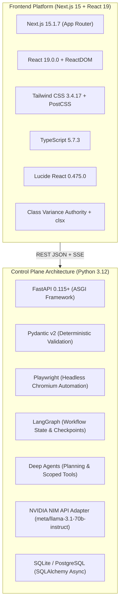

# MorphAPI Technology Stack & Dependency Matrix

## 1. Overview

MorphAPI combines a high-performance, modern React frontend console with a robust Python-based control plane and browser automation engine.

---

## 2. Technology Stack & Version Matrix

### Frontend Production Environment (Verified & Active)

| Component | Technology | Version | Purpose |
|---|---|---|---|
| **Framework** | Next.js | `^15.1.7` | App router, server-side rendering, client components, route handlers |
| **UI Library** | React | `^19.0.0` | Declarative UI rendering, hooks, concurrent features |
| **DOM Engine** | React DOM | `^19.0.0` | React web document binding |
| **Language** | TypeScript | `^5.7.3` | Static typing, interface contracts, compile-time safety |
| **Styling** | Tailwind CSS | `^3.4.17` | Utility-first CSS engine, mechanical layout design |
| **CSS Preprocessor** | PostCSS | `^8.5.2` | CSS transformation and autoprefixing |
| **Vendor Prefixes** | Autoprefixer | `^10.4.20` | Browser compatibility styling |
| **Icons** | Lucide React | `^0.475.0` | Clean, monoline SVG icon set |
| **Variant Styling** | Class Variance Authority | `^0.7.1` | Type-safe component variant management |
| **Class Utilities** | clsx & tailwind-merge | `^2.1.1` / `^3.0.1` | Dynamic and conflict-free className resolution |
| **Linter** | ESLint & eslint-config-next | `^9.20.1` / `15.1.7` | Static code analysis and Next.js lint rules |
| **Package Manager** | pnpm | `v9+` | Fast, disk-efficient package installation |
| **Runtime** | Node.js | `>=18.18.0` (tested on v24) | JavaScript/TypeScript server and tooling runtime |

---

### Control Plane & Extraction Engine (Architectural Specification)

| Component | Technology | Target Version | Purpose |
|---|---|---|---|
| **Language** | Python | `3.12+` | Async control plane runtime, type hints |
| **Web Framework** | FastAPI | `^0.115.0` | Async request routing, OpenAPI documentation, validation |
| **ASGI Server** | Uvicorn | `^0.32.0` | High-performance ASGI web server |
| **Validation** | Pydantic v2 | `^2.9.0` | Deterministic schema validation, field rules, type coercion |
| **Browser Engine** | Playwright | `^1.48.0` | Headless Chromium automation, DOM query execution, screenshot capture |
| **Agent Harness** | Deep Agents (`deepagents`) | Latest | Long-horizon planning, context compression, scoped tool execution |
| **Workflow State** | LangGraph | `^0.2.0` | State machine transitions, checkpoints, human-in-the-loop interrupts |
| **Inference Adapter** | NVIDIA NIM API | OpenAI-compatible | Selector hypothesis generation via `meta/llama-3.1-70b-instruct` |
| **HTTP Client** | HTTPX | `^0.27.0` | Async HTTP requests for NIM inference and external validation |
| **ORM / Persistence** | SQLAlchemy + aiosqlite | `^2.0.0` | Asynchronous database operations, migrations, and audit logging |
| **Protocol Engine** | Model Context Protocol SDK | `^1.0.0` | MCP server bindings for Claude Desktop and Cursor AI |

---

## 3. Layer Responsibility Matrix

| Architectural Layer | Core Responsibilities | What It Must NOT Do |
|---|---|---|
| **Next.js Frontend Console** | Render developer workbench, live telemetry streams, AST mutation diffs, playground query execution, and MCP configuration generators. | Never perform web scraping directly in the client browser or bypass backend validation rules. |
| **FastAPI Control Plane** | Manage endpoint lifecycles, tenant authorization, request routing, quota enforcement, and audit event recording. | Never invoke LLMs during normal high-speed extraction calls (`<400ms`). |
| **Playwright Worker** | Navigate to policy-approved URLs, wait for rendered DOM, inspect element attributes, test candidate selectors, and extract live values. | Never execute arbitrary shell code or navigate to disallowed local/private network addresses (SSRF). |
| **Pydantic v2 Validator** | Validate extracted raw values against customer-defined types, required field constraints, regex patterns, and range bounds. | Never permit unverified candidate configurations to be promoted to active status. |
| **LangGraph Coordinator** | Orchestrate multi-step healing loops, record checkpoint snapshots, enforce retry budgets, and manage human approval interrupts. | Never update business database records directly without atomic verification. |
| **NVIDIA NIM Adapter** | Pass sanitized DOM context to generative models to hypothesize replacement selectors when class churn occurs. | Never act as the verifier of its own output. Selector claims must be tested by Playwright. |

---

## 4. Key Architectural Trade-offs

### 1. Headless Browser (Playwright) vs. Static HTML Parsers (BeautifulSoup/lxml)
- **Decision**: Primary reliance on Playwright headless Chromium for dynamic DOM inspection and extraction.
- **Trade-off**: Playwright introduces memory and CPU overhead compared to static string parsing. However, modern websites rely heavily on client-side rendering (React, Vue, hydration), making static HTML parsers fail on dynamic content.
- **Mitigation**: Reusable browser context pooling and aggressive resource-blocking (disabling image/font downloads) to keep extraction latency under 400ms.

### 2. Pydantic v2 vs. LLM-as-a-Judge Validation
- **Decision**: Enforce strict deterministic Pydantic v2 validation rather than asking an LLM if the extracted data looks correct.
- **Trade-off**: Requires users to define explicit field types and constraints.
- **Benefit**: Eliminates non-deterministic LLM hallucinations, eliminates API token costs on the extraction path, and provides hard contractual guarantees to downstream enterprise pipelines.

### 3. Dual-Mode Client Layer (`ApiClient`)
- **Decision**: Equip the frontend with a dual-mode client capable of toggling seamlessly between offline deterministic fixtures (`MOCK FIXTURE`) and live backend API routing (`LIVE REST`).
- **Benefit**: Enables complete, interactive demonstration of complex workflows (AST diff inspection, MCP execution, DOM fracture simulation) even in standalone frontend environments, while providing an exact 1:1 drop-in interface for backend services.
