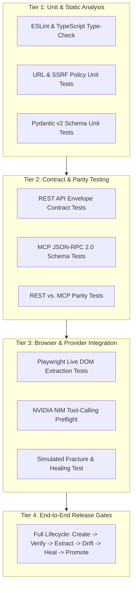

# MorphAPI Testing & Verification Strategy

## 1. Multi-Tier Testing Matrix

MorphAPI enforces a strict, multi-tier testing strategy to ensure that web extraction remains deterministic, self-healing workflows terminate reliably, and security invariants are never breached.



---

## 2. Test Suites & Verification Scope

### 1. Static Analysis & Type Checking
- **Frontend Linter**: `pnpm run lint` (ESLint 9 with Next.js rules, checks for unescaped JSX comments, accessibility, and react-hooks dependencies).
- **Type Safety**: `pnpm run type-check` (`tsc --noEmit`, guarantees 100% type conformance across all 12 routes, fixtures, and API client interfaces).
- **Bundle Compilation**: `pnpm run build` (Next.js 15 App Router production compile, verifies static and dynamic route generation).

### 2. URL Policy & SSRF Firewall Tests
- Tests that public hostnames (e.g. `books.toscrape.com`) pass validation.
- Tests that loopback addresses (`127.0.0.1`, `localhost`) are instantly blocked.
- Tests that private RFC 1918 subnets (`10.0.0.1`, `192.168.1.1`, `172.16.0.1`) throw `SSRF_BLOCKED`.
- Tests that cloud metadata endpoints (`169.254.169.254`) are intercepted before DNS resolution.
- Tests that wildcard scope filters reject out-of-scope redirections.

### 3. Playwright Browser Extraction Tests
- **Static DOM Tests**: Evaluates CSS selectors against controlled HTML fixtures.
- **Dynamic Hydration Tests**: Validates that Playwright waits for JavaScript frameworks (React hydration, client-rendered tables) before evaluating selectors.
- **Selector Match Invariants**: Verifies that match counts and sample values match expected counts without throwing unhandled exceptions.

### 4. NVIDIA NIM Tool-Calling Compatibility Preflight
Before enabling autonomous healing for an environment, an automated preflight probe verifies:
1. HTTP connectivity and Bearer token authentication to `https://integrate.api.nvidia.com/v1`.
2. Model invocation for `meta/llama-3.1-70b-instruct`.
3. Tool definition transmission (`tools` parameter) and verification that the model emits a valid `tool_calls` array.
4. Parsing of arguments generated by the model against the target JSON schema.
5. If any step fails, agentic healing is disabled and the system refuses to silently fall back to an unverified model.

### 5. REST & MCP Parity Tests
To prevent divergence between human API consumers and AI assistants, parity tests verify that:
- `GET /api/v1/endpoints/{slug}/extract`
- and MCP tool call `extract_endpoint_data(endpoint_id)`
execute the exact same Playwright extraction logic, apply identical Pydantic v2 validation rules, and return equivalent data payloads.

---

## 3. Release Acceptance Criteria (10 Mandatory Gates)

A release candidate is approved for production deployment **only if all 10 gates pass**:

1. **Gate 1 (Draft Creation)**: A user can create a draft endpoint from a starting URL and natural language schema description.
2. **Gate 2 (Real Browser Verification)**: A Playwright browser worker navigates to the live page and extracts actual sample values.
3. **Gate 3 (Deterministic Validation)**: Pydantic v2 validator accepts valid field data and rejects invalid types.
4. **Gate 4 (No Activation on Model Claim)**: Only configurations that pass real browser checks can be promoted to active status. The LLM cannot mark a candidate verified.
5. **Gate 5 (Bounded Healing Execution)**: A simulated DOM selector break starts a bounded LangGraph workflow with hard retry limits (max 3 cycles) and timeouts.
6. **Gate 6 (NIM Tool-Calling Gate)**: The exact configured NVIDIA NIM endpoint and model pass tool-calling preflight.
7. **Gate 7 (Resumable Workflow)**: A checkpointed workflow can be paused (human approval interrupt) and resumed without duplicate version promotions.
8. **Gate 8 (REST / MCP Parity)**: REST and MCP interfaces return identical data schemas and error codes for the same active endpoint.
9. **Gate 9 (SSRF & Prompt Injection Defenses)**: Security tests prove that private subnets, cloud metadata IPs, and prompt injection attempts embedded in target HTML are neutralized.
10. **Gate 10 (Zero Fake Success)**: Any failure (browser timeout, selector drift, schema mismatch) is made clearly visible as degraded/failed, and never concealed behind fake or stale data.

---

## 4. Automated Verification Commands

Run the following commands in the `Frontend/` directory to verify release readiness:

```bash
# 1. Run ESLint checks
pnpm run lint

# 2. Run TypeScript compilation check
pnpm run type-check

# 3. Compile Next.js production build
pnpm run build

# 4. Verify production server boot
pnpm start
```
